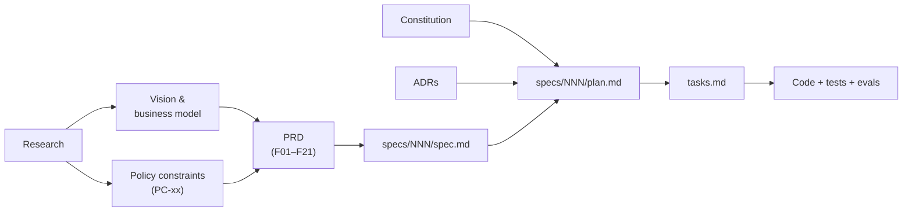

# Guidesk Documentation

| Area | Document | What it answers |
|---|---|---|
| **Product** | [Vision](product/vision.md) | Why Guidesk exists, for whom, and how it is positioned |
| | [Business model](product/business-model.md) | Lean Canvas, plans, commissions, unit economics, go-to-market |
| | [Personas](product/personas.md) | Hosts, managers, guests, providers |
| | [PRD](product/prd.md) | Feature catalog (F01–F21), requirements, agent rules, metrics |
| | [Roadmap](product/roadmap.md) | Phases, exit criteria, business track |
| **Research** | [Integrations](research/integrations.md) | How to reach the Airbnb, Booking.com, and Vrbo chats: options, costs, viability |
| | [Competitive landscape](research/competitive-landscape.md) | Competitors, gaps, threats |
| | [Monetization partners](research/monetization-partners.md) | Tours, insurance, payments |
| | [Platform policies](research/platform-policies.md) | OTA rules that constrain the product (PC-xx) |
| **Architecture** | [Overview](architecture/overview.md) | C4 context and containers, flows, data model, repository layout |
| | [ADRs](architecture/adr/README.md) | Recorded decisions |
| | [Security](architecture/security.md) | Data classes, threat model (STRIDE), controls SEC-01 to SEC-21 |
| | [Performance](architecture/performance.md) | Targets and budgets, guide delivery, agent latency, load testing |
| **Process** | [Constitution](../.specify/memory/constitution.md) | Non-negotiable engineering principles (Spec Kit) |
| | [Open questions](open-questions.md) | Pending decisions, partner applications, assumptions |
| | [Glossary](glossary.md) | Shared vocabulary |

Feature specifications live in [`/specs`](../specs/), one folder per feature, created with
Spec Kit.

## How the documents relate

