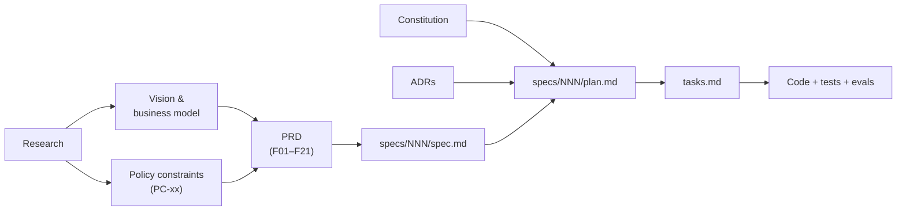

# Guidesk Documentation

| Area | Document | What it answers |
|---|---|---|
| **Product** | [Vision](product/vision.md) | Why Guidesk exists, for whom, and how it is positioned |
| | [Business model](product/business-model.md) | Lean Canvas, plans, commissions, unit economics, go-to-market |
| | [Personas](product/personas.md) | Hosts, managers, guests, providers |
| | [PRD](product/prd.md) | Feature catalog (F01–F21), requirements, agent rules, metrics |
| | [Roadmap](product/roadmap.md) | Phases, exit criteria, business track |
| **Research** | [Integrations](research/integrations.md) | How to reach the Airbnb, Booking.com, and Vrbo chats: options, costs, viability |
| | [Competitive landscape](research/competitive-landscape.md) | Competitors, gaps, threats |
| | [Monetization partners](research/monetization-partners.md) | Tours, insurance, payments |
| | [Platform policies](research/platform-policies.md) | OTA rules that constrain the product (PC-xx) |
| **Architecture** | [Overview](architecture/overview.md) | C4 context and containers, flows, data model, repository layout |
| | [ADRs](architecture/adr/README.md) | Recorded decisions |
| | [Security](architecture/security.md) | Data classes, threat model (STRIDE), controls SEC-01 to SEC-21 |
| | [Performance](architecture/performance.md) | Targets and budgets, guide delivery, agent latency, load testing |
| **Design** | [UX index](ux/README.md) | Status of the UX docs, what is provisional, gaps found while designing |
| | [Principles and IA](ux/principles-and-ia.md) | Design principles, sitemaps, mobile navigation, what each role sees |
| | [User flows](ux/user-flows.md) | Nine end-to-end flows with key states |
| | [Screen inventory](ux/screens.md) | Every screen by surface, persona, and phase |
| | [Design system](ux/design-system.md) | Color tokens, typography, components, accessibility, i18n |
| | [Brand guide](brand/README.md) | Logo, palette, type, icons, imagery, and usage rules |
| | [Wireframes](ux/wireframes.html) | Low-fidelity mobile wireframes of 12 key screens |
| **Presentation** | [Project overview](presentation/project-overview.md) | Guidesk in plain language for investors, partners, and pilot hosts |
| | [Budget](presentation/budget.md) | Development and operating costs per scenario, with sources |
| | [Interactive presentation](presentation/interactive/index.html) | A 31-slide walkthrough to present the whole project: problem, product, guided demos, architecture, business and fees, status, and the road to the demo and the pilot (Spanish and English) |
| **Process** | [Constitution](../.specify/memory/constitution.md) | Non-negotiable engineering principles (Spec Kit) |
| | [Open questions](open-questions.md) | Pending decisions, partner applications, assumptions |
| | [Pilot readiness](pilot-readiness.md) | Everything the founder must do before the first pilot guest |
| | [Partner outreach](partner-outreach.md) | Drafts of the questions for Tilopay, Beds24, Hostex, Viator, and Civitatis, and the SES production access request |
| | [Glossary](glossary.md) | Shared vocabulary |

Feature specifications live in [`/specs`](../specs/), one folder per feature, created with
Spec Kit.

## How the documents relate

