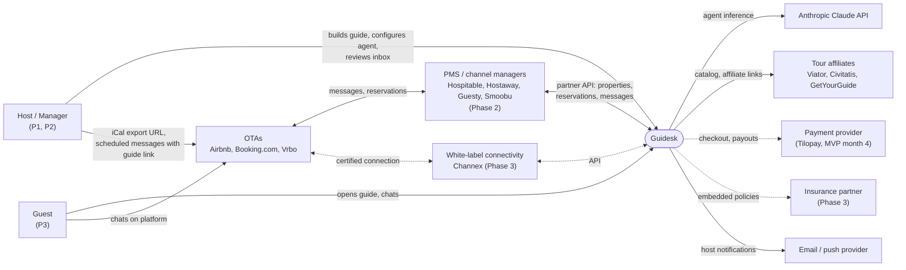
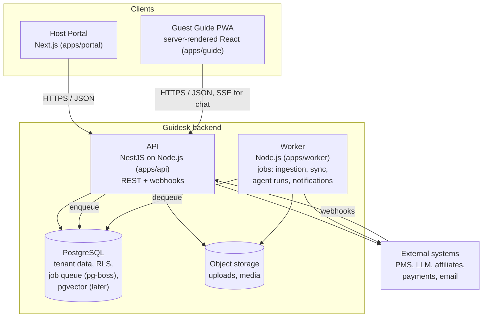
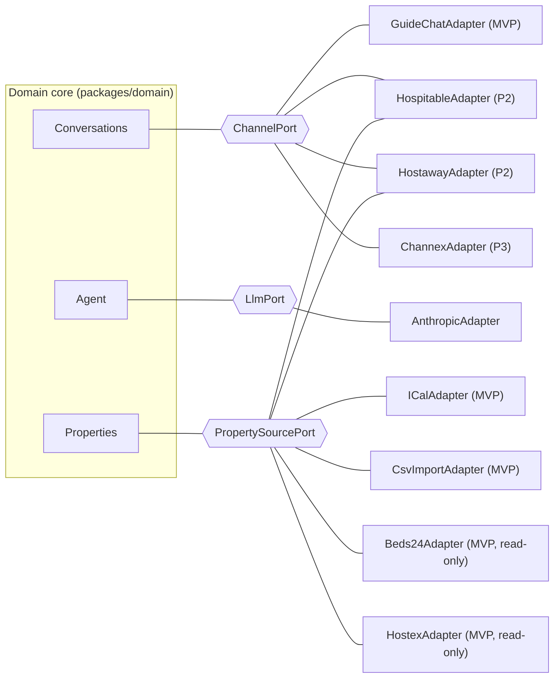
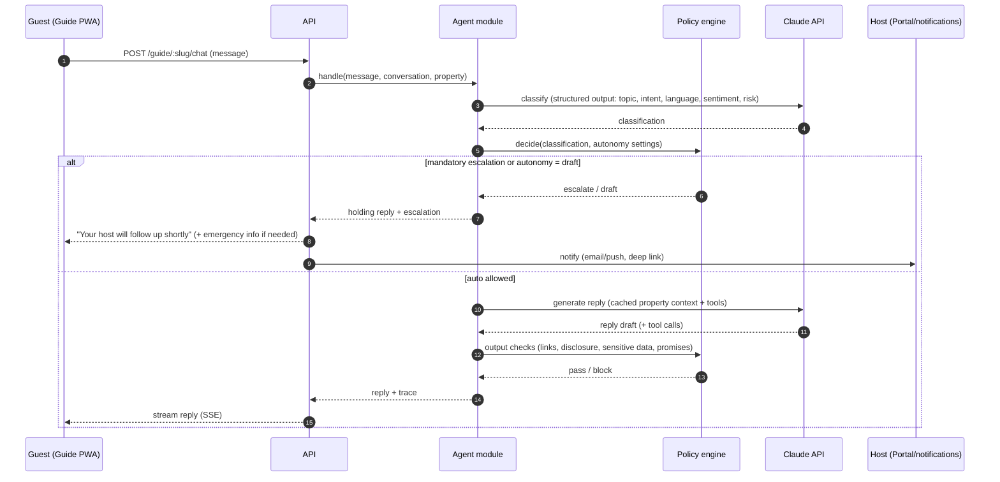
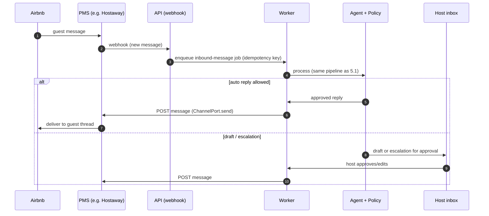
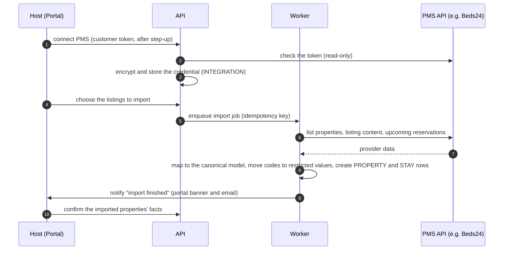
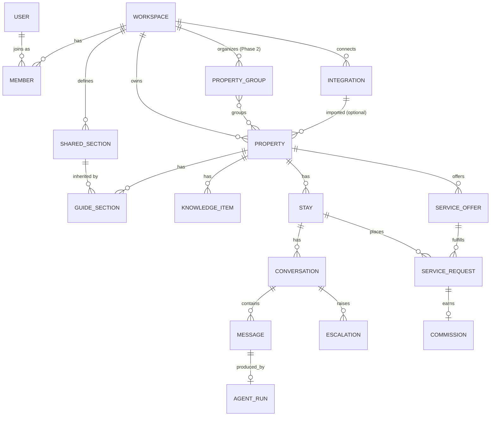

# Architecture Overview

> **Status:** Draft v0.1 · **Owner:** Founder · **Last updated:** 2026-11-13 ·
> **Related:** [ADRs](adr/README.md) · [PRD](../product/prd.md) · [Constitution](../../.specify/memory/constitution.md)

This document describes the target architecture for Guidesk at the level needed to write
feature specs and plans. It follows the [C4 model](https://c4model.com/): context, then
containers, then components. Decisions are recorded in [ADRs](adr/README.md). Each feature's
`plan.md` refines the relevant part of this document.

## 1. Architectural drivers

| Driver | Source | Architectural response |
|---|---|---|
| Integrate only through official channels; the integration landscape will change | Constitution II and IV; [ADR-0003](adr/0003-phased-channel-integration-strategy.md) | Channel-agnostic core with ports and adapters for PMS, OTA, and white-label providers |
| Accurate and safe AI behavior with human oversight | Constitution III and V | Deterministic policy engine around the LLM ("the LLM proposes, code decides"), per-topic autonomy, and an eval gate |
| One developer working with AI agents | Constitution I and VII | TypeScript monorepo, managed services, and few moving parts ([ADR-0004](adr/0004-typescript-monorepo-stack.md)) |
| Multi-tenant SaaS holding sensitive property data | Constitution VI | `workspace_id` on every tenant row, Postgres row-level security, field-level encryption of restricted data, gated sensitive fields ([security](security.md)) |
| Guest guide on mobile across the Americas | NFR-01 and NFR-07 | Static-first PWA on a CDN with performance budgets; the guide works even when the agent is down ([performance](performance.md)) |
| AI inference is the main variable cost | [Business model](../product/business-model.md) | Prompt caching of property context, per-route effort tuning, a cost trace on every message, and a hybrid knowledge strategy (pgvector in the same Postgres) when switch triggers fire ([ADR-0005](adr/0005-llm-provider-and-agent-design.md)) |

## 2. System context (C4 level 1)



In the MVP, Guidesk has no API connection to any OTA. The host sends the guide link through the
OTA's native scheduled messages and shares the OTA iCal export URL for stay windows. Guest chat
happens inside the guide. From Phase 2, PMS adapters bring in OTA messages.

## 3. Containers (C4 level 2)



| Container | Responsibility | Tech (see ADR-0004) |
|---|---|---|
| Host Portal | Onboarding, guide builder, inbox and copilot, agent settings, catalog, analytics, integrations wizard, billing | Next.js (App Router), React, Tailwind, shadcn/ui. Mobile-first, installable PWA with web push ([ADR-0006](adr/0006-web-first-pwa-no-native-apps.md)) |
| Guest Guide PWA | Public, localized guide; gated sensitive section; chat; offers with disclosure | Server-rendered React without hydration on AWS Lambda behind its own CloudFront distribution, a small browser script, and a PWA service worker ([ADR-0010](adr/0010-guest-guide-server-rendered-without-client-framework.md)) |
| API | Auth, tenancy, CRUD, guest chat endpoint (streaming), PMS webhooks, affiliate redirects, policy engine | NestJS (Fastify adapter), Zod contracts, OpenAPI |
| Worker | Document extraction, translations, iCal sync, PMS sync, inbound message processing, agent runs for platform chats, notifications | Node.js and pg-boss, sharing the domain packages |
| PostgreSQL | System of record, job queue, and vector search when needed | Managed Postgres 16+, Drizzle ORM, RLS |
| Object storage | Uploaded documents, images, videos | S3-compatible storage |

## 4. Components and bounded contexts

The domain is split into modules with explicit boundaries. Modules communicate through
application services and domain events, never through each other's tables.

| Context | Owns | Key ports |
|---|---|---|
| **Identity and Tenancy** | Users, workspaces, members (a user can join several workspaces), roles, invitations, plans and limits | `AuthProviderPort` |
| **Properties** | Properties, stay windows (reservations), property facts, imports and duplication | `PropertySourcePort` (iCal, CSV, PMS) |
| **Knowledge and Guide** | Guide sections, shared workspace sections and their inheritance, knowledge items, sensitive fields, translations, completeness | `DocumentExtractionPort`, `TranslationPort` |
| **Conversations** | Channel-agnostic conversations and messages, inbox, escalations | `ChannelPort` (guide chat, PMS, white-label) |
| **Agent** | Classification, policy engine, reply generation, tools, traces, evals | `LlmPort` |
| **Commerce** | Service catalog, add-on requests and orders, affiliate offers, disclosures, commissions | `AffiliateCatalogPort`, `PaymentPort` (Tilopay, MVP month 4), `InsurancePort` (Phase 3) |
| **Integrations** | Connections, credentials, sync state, adapter registry | Implements the ports above per provider |
| **Notifications** | Host email and push | `NotificationPort` |
| **Analytics** | Metrics, events, dashboards | — |

### Ports and adapters



In the MVP, PMS adapters implement only `PropertySourcePort`, for read-only import. Hostaway
joins them if its terms allow a customer's API key before partner approval (OQ-26). The PMS
`ChannelPort` side (messaging) starts in Phase 2.

**`ChannelPort` (sketch; final contract in spec 012):**

- `receive(event) → InboundMessage`: normalizes webhooks or polled messages.
- `send(conversationRef, OutboundMessage) → DeliveryResult`
- `capabilities() → { attachments, maxLength, sendWindow, ... }`: for example, Booking.com allows
  messages from reservation until 7 days after checkout.

## 5. Key flows

### 5.1 Guest asks a question in the guide chat (MVP)



*As built in spec 005:* the API stores the guest's message (`POST /api/v1/guest/chat/messages`) and
queues `chat.reply`; the worker runs the budget check, the classification, the policy, the answer from
the published guide, and the output checks, then writes the reply, holding reply, or draft with a trace.
The chat polls for messages (every 1.5 seconds while a reply is pending, every 5 seconds otherwise)
instead of streaming, because a reply is shown only after its checks pass. There are no tools yet. With
autonomy `draft` (the default) members send, edit, or replace drafts from the property's conversation
page; the full inbox is spec 006.

*As built in spec 007:* the worker reads the assistant settings (one row per workspace and per
property, resolved per group by the domain) before deciding. Autonomy is per topic; the tone and the
host's custom instructions go into the answer call's cached prefix; quiet hours in the property's time
zone hold non-urgent "needs the host" emails, and a per-minute job (`chat.quiet-digest`) sends one
summary per contact when they end. "Test the assistant" runs the same pipeline in dry-run mode
(`assistant.test`) and writes only the result, a trace, and the usage.

*As built in spec 006:* members work from one inbox (`GET /api/v1/workspaces/{id}/inbox`, tabs "Needs
you", "All", and "Done", emergencies first, filtered by property, polled every 15 seconds). A member can
mark a conversation done (a new guest message or reply reopens it), discard a draft, and take a
conversation over: the worker still classifies each guest message, so an emergency shows its card and
alerts everyone, but otherwise sends nothing and marks it "needs the host" with reason `taken_over`,
alerting only the member who took it. A 30-second presence heartbeat shows who is replying. The
paste-to-reply copilot stores the pasted message and queues `copilot.draft`; the worker runs the same
classification, guide knowledge (without benefit recommendations), answer call (channel `platform`,
written as the host), and checks, uses fixed texts for emergencies and code requests, removes links and
contact details for inquiries, and counts the usage toward the daily budget. Alerts also go by web push
(VAPID): the reply job and the quiet hours digest queue `notification.push` jobs with IDs only, and the
worker renders a title and a short reason, never guest text. The portal registers `/sw.js` and a web
app manifest so it can be added to an iPhone home screen (ADR-0006).

*As built in spec 009:* the guest guide has an Explore page (a tile on the guide home): the host's
recommendations first, then up to 12 partner experiences near the property, grouped by category, each
with a commission disclosure. A worker job (`explore.refresh`, every 30 minutes and at start) searches
Viator's affiliate API for each destination with published guides and keeps the results at most an hour,
Viator's limit; Civitatis entries come from a curated file in the repository. Guest requests read only
stored results. "Book on {partner}" goes through `/api/v1/guest/guides/{publicId}/experiences/{ref}/go`
on the guide origin, which redirects only to the stored partner page of an experience the property
shows and counts marked taps per day without personal data. Owners and admins choose what guests see
per property and as a workspace default. The guide chat may point guests to Explore; copilot drafts
never do.

*As built in spec 008:* the guest guide has an Extras page (a tile on the guide home when the property
shows extras): optional services the host offers, with the price or "Free". On a stay link inside its
window (verified when the stay requires the code) the guest picks a date and time when the extra needs
them, adds an optional note, and requests it; the API checks the extra's rules in the property's time
zone and takes the name, price, and stay from the catalog and the session, never the body. Pre-approved
extras are confirmed at once; others wait for the host. A worker job (`service-request.tick`, every
minute) alerts the escalation contacts by email and push after quiet hours, expires waiting requests when
their lead time passes (48 hours for extras without a date), and cancels waiting requests of stays that
are no longer active. Members answer from Requests (`/requests`); owners and admins manage each
property's catalog. No payment happens in Guidesk yet: a confirmed request says the host will arrange
payment (checkout is spec 013). The guide chat may name the host's extras with the Extras link when a
guest asks; copilot drafts never do.

*As built in spec 010:* members see Analytics for a property (`/properties/{id}/analytics`) or the
workspace (`/analytics`) over 7, 30, or 90 days by each property's local day, against the previous
period: guide views by link kind, stays that opened the guide (`stay.guide_opened_at`, set by the
stay-session exchange), guest questions by outcome from the assistant's traces (copilot runs and tests
excluded) with the automated resolution rate, topics, escalation reasons, unanswered questions linking to
their conversations, Explore opens and partner clicks, and add-on requests with the attach rate. The API
reads the existing records and daily counts on request; there is no analytics store and no guest
tracking. The founder's pilot metrics (PRD §8) come from `pnpm --filter @guidesk/db report:pilot`, run
with database access outside the portal, which prints aggregates only.

*As built in spec 011:* every workspace has a plan (Free, Pro, or Business, defined in
`packages/domain/src/plans/`) that limits active properties, AI replies per UTC month, and seats
(members plus pending invitations); Guidesk may set a custom limit per workspace. AI replies are the
model replies the worker already counts per property and day (guide chat, copilot, tests); at the
month's limit the worker makes no model call, the guest gets the holding reply, and the conversation
waits for the host with the reason `monthly_limit`. A 5-minute job (`plan-usage.tick`) emails owners
once at 80% and once at 100%. Every property path and invitation enforces the effective limits; a
workspace above a limit keeps everything it has. Owners and admins see Plan and limits
(`/settings/plan`) and a banner at 80%; the founder changes plans with
`pnpm --filter @guidesk/db plan:set`, never through the API, and each change is in the security log.
There is no billing yet (Phase 2).

*As built in spec 013 (with a simulated provider):* guests pay confirmed add-ons through the
provider's hosted checkout behind `PaymentPort` (`packages/integrations/src/payments/`). The API starts
one checkout per request from the stay session, using only the stored request's amount, and an order
becomes paid only through a verified provider event (`POST /api/v1/payments/events/{provider}`,
recorded once in `payment_event`). Orders keep the price, Guidesk's platform fee (by plan or agreed),
the provider's fee, and the host's share in minor units; the host's share settles to the host's
provider account (split settlement). Owners set up payouts on the provider's page; owners and admins
refund with re-authentication; disputes are flagged and emailed by `payment.notify`. `PAYMENTS_MODE`
is `simulated` locally (hosted pages under `/api/v1/simulated-provider/*`) and `off` in production
until the Tilopay adapter exists (OQ-01, OQ-37).

### 5.2 Guest writes in the Airbnb chat (Phase 2, through a PMS)



### 5.3 Revealing sensitive information

1. The guest opens the guide through the link the host sent with OTA scheduled messages.
2. A sensitive section (for example, the door code) asks for verification. The method is defined
   in spec 004: a reservation-scoped link, a confirmation code, or a host PIN.
3. The API checks the verification and the stay window (from iCal or PMS), then returns the
   values. Every reveal is logged.
4. The agent never reads sensitive values into the prompt. When a guest asks for one, the agent
   points to the verified section. The rule is enforced in code.

### 5.4 Guide drafts from a PMS import (MVP, read-only)



Feature 002 ends here: the properties exist with their facts, listing content, and stays.
Drafting guide sections from that content, with completeness gaps and the AI interview, belongs to
spec 003 (the guide builder). After the import, the worker refreshes upcoming reservations
read-only every 3 hours and on "Refresh now".

Sensitive values go straight from the provider to encrypted fields and never reach the LLM. The
same pipeline serves CSV imports, pasted text, and screenshots. Only the source step differs.

## 6. Data model (conceptual)



Notes:

- Every tenant-owned table has a `workspace_id`, and RLS policies enforce it.
- `USER` is a global identity linked to the auth provider and is not tenant-owned. `MEMBER`
  links a user to a workspace with a role. A user can be a member of several workspaces, and all
  access to tenant data goes through a membership.
- `SHARED_SECTION` holds workspace-level guide content. A `GUIDE_SECTION` does one of three
  things: inherits a shared section, overrides it locally, or exists only for its property.
  - The guide renderer and the agent's `ContextAssembler` resolve the inheritance.
  - Editing a shared section changes the prompt prefix of every property that inherits it, so
    those prompt caches are rebuilt. This is expected.
- `PROPERTY.source` is `manual`, `csv`, `duplicate`, or a PMS adapter. Imported properties keep
  the provider's `external_id` for re-import and, in Phase 2, continuous sync.
- `PROPERTY_GROUP` and per-property member permissions arrive in Phase 2 (F21).
- `STAY` is the canonical reservation. It is sourced from iCal (dates only), a PMS (full data),
  or manual entry. Guest personal data is minimal and has a retention policy.
- `CONVERSATION.channel` is `guide_chat`, `airbnb`, `booking`, `vrbo`, or `direct`, with the
  `source_adapter` that carried it.
- `AGENT_RUN` stores the classification, the policy decision, tool calls, model, token usage,
  cost, and latency.

## 7. Cross-cutting concerns

| Concern | Approach |
|---|---|
| Security | Data classes, threat model, and controls SEC-01 to SEC-21 in the [security architecture](security.md). |
| Performance | Targets, budgets, and degraded modes in the [performance architecture](performance.md). |
| Authentication | Host auth for the portal with Better Auth, self-hosted ([ADR-0008](adr/0008-authentication-better-auth.md)): passwordless sign-in, passkeys, MFA, and step-up re-authentication (SEC-05). Guests are anonymous, with a guide-scoped session plus verification for sensitive data (SEC-01 to SEC-03). |
| Authorization | Role-based access per workspace (`owner`, `admin`, `agent`). RLS as defense in depth. |
| Secrets | PMS tokens and API keys are encrypted at the application level (envelope encryption) and never logged. |
| Idempotency | Every inbound webhook and every outbound message has an idempotency key, so retries never double-send. |
| Internationalization | Spanish and English message catalogs; per-property time zone; money stored as integer minor units plus an ISO currency code. |
| Observability | OpenTelemetry traces across API, worker, and LLM calls; structured logs; error tracking; an agent trace viewer in the back-office. |
| Testing | Unit tests (domain), contract tests (adapters, with recorded fixtures), integration tests (API and DB), E2E tests (Playwright), and agent evals (golden conversations) gated in CI. |
| Environments | `local` (Docker Compose for Postgres and Mailpit), `preview` (portal per pull request, sharing the staging database), `staging`, `production`, on AWS `us-east-1` with SST ([ADR-0009](adr/0009-mvp-hosting-and-transactional-email.md)). |

## 8. Repository layout

Specs 001 to 003 built the portal, API, worker, and sandbox, and the packages marked ✓. The rest
arrive with later features.

```text
guidesk/
├── .specify/                 # Spec Kit (constitution, templates, scripts)
├── specs/                    # One folder per feature: spec.md, plan.md, tasks.md, contracts/
├── docs/                     # Product, research, architecture, ADRs
├── infra/                    # ✓ SST: network, database, services, router, email, secrets
├── apps/
│   ├── portal/               # ✓ Host portal (Next.js)
│   ├── guide/                # Guest guide PWA (server-rendered React, ADR-0010)
│   ├── api/                  # ✓ NestJS API + webhooks
│   ├── worker/               # ✓ Background jobs (pg-boss)
│   └── sandbox/              # ✓ Lambda functions for untrusted links and files (feed reader, file processor)
├── packages/
│   ├── domain/               # ✓ Pure domain model + application services (no framework)
│   ├── contracts/            # ✓ Zod schemas, OpenAPI, shared types
│   ├── db/                   # ✓ Drizzle schema, migrations, RLS policies
│   ├── emails/               # ✓ Transactional email templates (React Email), Spanish and English
│   ├── observability/        # ✓ Sentry and OpenTelemetry setup, with scrubbing
│   ├── testing/              # ✓ Shared test helpers (disposable PostgreSQL with migrations)
│   ├── agent/                # Prompts, tools, policy engine, eval harness
│   ├── integrations/         # ✓ Ports and adapters: auth, email, storage, KMS, sandbox, PMS, the model, speech to text
│   ├── ui/                   # ✓ Shared React components (the guide document renderer so far)
│   ├── i18n/                 # ✓ Message catalogs
│   └── config/               # ✓ tsconfig, eslint, prettier presets
├── e2e/                      # ✓ Playwright end-to-end and accessibility tests
├── perf/                     # ✓ k6 load tests
└── evals/                    # ✓ Eval suites: listing extraction; guide drafting, interview, translation
```

Performance budgets are enforced in CI by the bundle-size check and Lighthouse CI on a local
production build of the portal, until preview deployments exist ([performance](performance.md)).
