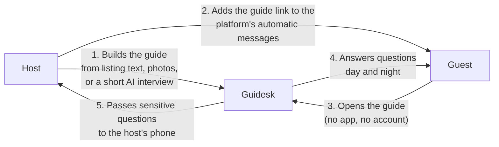
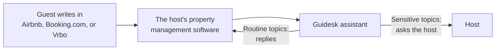
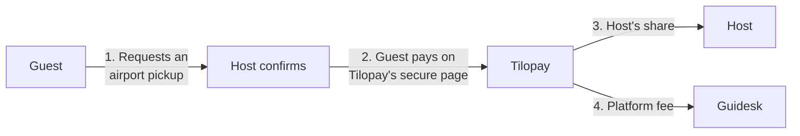
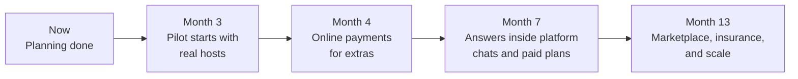

# Guidesk: Project Overview

> **Status:** Draft v0.1 · **Owner:** Founder · **Last updated:** 2026-11-14 ·
> **For:** investors, partners, and pilot hosts · **Related:** [Budget](budget.md) · [Wireframes](../ux/wireframes.html) · [Vision](../product/vision.md) · [Roadmap](../product/roadmap.md)

This is Guidesk in plain language. It is written for people who are not engineers. The
detailed planning documents are linked at the end of each section for anyone who wants more.

## 1. Guidesk in one minute

- **What it is:** a digital guidebook for each vacation rental, plus a virtual assistant that
  answers guests' questions at any hour, in Spanish or English.
- **Who it is for:** people who rent out homes on Airbnb, Booking.com, and Vrbo, from someone
  with one apartment to companies with hundreds of units, in Latin America and the United
  States.
- **Why it matters:** hosts answer the same questions over and over, often at night and in a
  second language. Guests want answers now. Guidesk handles the routine questions and passes
  anything sensitive to the host.
- **How it earns money:** a free plan to start, a paid plan for more features, and commissions
  on optional services guests choose, such as tours or an airport pickup.
- **Where it stands:** planning is complete. The first version takes 4 months to build. A pilot
  with real hosts starts at the end of month 3, and online payments follow in month 4.

## 2. The problem

Short-term rental hosts run a hospitality business from their phones.

- **The same questions, every stay.** "What's the Wi-Fi password?" "Where is the key?" "How does
  the air conditioning work?" Hosts answer them again and again, at all hours.
- **Information is scattered.** It lives in listing text, PDFs, phone notes, and the host's
  memory. Guests rarely read long house manuals, so they message the host anyway.
- **Money is left on the table.** Guests ask what to do or whether they can get an airport
  pickup. Most hosts improvise or say no.
- **Existing tools were built for someone else.** Most are English-first, expensive, sold by
  quote, or require professional software that small hosts don't use. Hosts in Latin America
  are largely unserved.

## 3. Who it is for

These are fictional composites based on market research. The pilot will replace them with real
interviews.

**Ana, a host with two beach apartments in Costa Rica.** She has a day job and rents her places
on Airbnb. Guests write at 11 pm asking where the key box is. Answering in English takes her
time. Her PDF manual goes unread. She would offer airport transfers but doesn't want to chase
payments. *She needs a guide she can set up from her phone in under 30 minutes, for free, in
Spanish, with no risk to her Airbnb account.*

**Marco, who manages 60 rentals with a small team.** His company runs everything through
property management software. His support team grows with every new unit, and answers are
inconsistent. He once tried an automatic responder and turned it off after it gave a wrong answer
about parking. *He needs an assistant he can control, topic by topic, that works inside his
existing tools and shows him the time and money it saves.*

**Emily, a guest from the United States.** She arrives at night after a long drive, on mobile
data, and doesn't speak Spanish. She doesn't want to download an app or create an account.
*She needs the door code and the Wi-Fi in seconds, answers at midnight, and suggestions that don't
feel like a sales pitch.*

**Luis, a local tour and transfer operator (later phase).** He depends on word of mouth from
hosts. *He wants hosts to recommend his services through their guides and to get paid reliably.*

More detail: [personas](../product/personas.md).

## 4. What Guidesk does

Guidesk has three layers. Each one builds on the one before.

| Layer | What it is | Why it matters |
|---|---|---|
| **1. The guide** | A mobile web guide for each property: arrival, Wi-Fi, house rules, appliances, local tips, emergencies, checkout. Guests open it from a link or a QR code. No app, no account. | It is useful on day one and free to start, so hosts adopt it without having to trust AI first. |
| **2. The assistant** | An AI assistant that has read the host's guide. Guests chat with it inside the guide now; later it will also answer inside the Airbnb, Booking.com, and Vrbo chats. Hosts choose, topic by topic, whether it replies on its own or drafts replies for approval. | Guests get instant answers. Hosts get their evenings back. Anything sensitive, such as an emergency or a refund request, always goes to a person. |
| **3. The marketplace** | Optional extras offered at the right moment: the host's own services (airport pickup, extra cleaning), tours and experiences from partners, and later reservations and insurance. Every offer says clearly when someone earns a commission. | Extra income for the host and for Guidesk, without pressure on the guest. |

Guidesk is **not** a booking platform or property management software. It never handles
bookings, prices, or calendars, and it never moves a booking or its payment off the platform
where it was made.

## 5. How it works

### 5.1 In the first version

1. **The host builds the guide in minutes.** Guidesk drafts it from the host's listing text,
   screenshots, or (for larger managers) their property software. The host fills gaps by
   answering a short interview, by typing or by voice, and then reviews and publishes it.
2. **The host shares one link.** The link goes into the automatic messages the host already
   sends through Airbnb, Booking.com, or Vrbo after a booking. A printable QR code can hang in the
   home.
3. **The guest opens the guide.** It opens in their language. The door code only appears to the
   confirmed guest, during their stay.
4. **The assistant answers.** It replies from the host's guide and says which section it used.
   When it is not sure, it says so and asks the host.
5. **The host stays in control.** Sensitive topics (emergencies, complaints, refunds, booking
   changes) always go to the host. New accounts start with the assistant drafting replies for
   the host to approve with one tap.

Hosts who chat with guests inside Airbnb can also paste a guest's message into Guidesk and get a
ready-to-send reply, checked against the platforms' rules.

See the screens: [wireframes](../ux/wireframes.html).

### 5.2 Later: inside the platform chats

The rental platforms do not let new companies connect directly. Guidesk will connect through the
property management software that professional managers already use, through official partner
programs. Applications start now; approvals take an unknown amount of time.

### 5.3 How an extra is sold

Tilopay is a Costa Rican payment company. The guest pays on Tilopay's page, so card numbers never
pass through Guidesk. How the host's share is paid out is being confirmed with Tilopay (OQ-37).

## 6. Features by phase

| Phase | When | What hosts and guests get |
|---|---|---|
| **First version (MVP)** | Months 0–4. Pilot at the end of month 3, payments in month 4 | Sign-up with Google, a passkey, or an email code (no passwords) · teams with roles · guides drafted from listing text, screenshots, documents, or some property software · AI interview by text or voice · Spanish and English versions · the guest guide with protected door codes · the in-guide assistant · the host inbox with one-tap approvals · the reply helper for platform chats · host extras with requests and, from month 4, online payment · tours from partners · basic statistics |
| **Phase 2** | Months 4–7 | The assistant answers inside the Airbnb, Booking.com, and Vrbo chats for hosts who use partner property software · one inbox for all conversations · paid plans · groups of properties and owner access · car rental, transfer, and restaurant partners |
| **Phase 3** | Months 7–13 | Platform chats for hosts without property software · optional travel insurance through a licensed partner · a marketplace where local providers list their services · booking tours without leaving the guide · tools for large companies to connect their own systems · Portuguese if Brazil is confirmed |

Details: [product requirements](../product/prd.md#4-feature-catalog-and-prioritization) and
[roadmap](../product/roadmap.md).

## 7. How it makes money

**Plans (prices are hypotheses to test in the pilot):**

| | Free | Pro | Business |
|---|---|---|---|
| For | Hosts trying Guidesk | Individual hosts and small managers | Managers with 10+ rentals and teams |
| Price | $0 | About $9–12 per property per month | Volume pricing |
| Highlights | Up to 2 properties, the guide, the assistant with a monthly reply limit | Unlimited properties, more autonomy, connection to property software | Teams, approvals, reports, and an integration option |

**Commissions on optional services:**

| Service | How Guidesk earns | Typical rate | When |
|---|---|---|---|
| Tours and experiences | Partner commission when a guest books through Guidesk's link | About 8–10% | First version |
| Host extras (pickup, cleaning, rentals) | A platform fee on what the guest pays | About 5–10% | Month 4 |
| Reservations (cars, transfers, restaurants) | Partner commission | Set by each partner | Phase 2 |
| Insurance | Revenue share with a licensed partner | Not public | Phase 3 |

**An example per rental per month** (assumptions, to be measured): 4 stays bring about $3.84 in
tour commissions and $2.80 in extras fees, about $6.64 in total, plus about $9–12 if the host is
on Pro. The AI costs about $1.80–6.60 per rental per month, so the free plan needs a reply limit.

Details: [business model](../product/business-model.md).

## 8. Roadmap and milestones

The start date is still open (OQ-02). Months count from the start of development.

| Milestone | What "done" means |
|---|---|
| Planning complete (now) | Product, research, architecture, security, and the first feature specification are written and decided. |
| Pilot (end of month 3) | 10–20 individual hosts and 3–5 managers use Guidesk with real guests. All protections are in place before the first guest. |
| Payments (month 4) | Guests pay for extras online; Guidesk collects its first fees. Needs a legal entity and a Tilopay account by week 10. |
| End of the pilot | Measured results: at least half of new hosts publish a guide and send it to a guest within 7 days, at least 60% of guest questions answered without the host, at least 95% of answers correct, and zero warnings or suspensions from any rental platform caused by Guidesk. Pricing decided from evidence. |
| Phase 2 (month 7) | At least one property-software partner live; paid plans live. |

Details: [roadmap](../product/roadmap.md).

## 9. Why it is safe for hosts

Hosts worry about two things: losing their listing, and someone getting into their home. Guidesk
is designed around both.

**Staying within the platforms' rules:**

- **The guide is optional.** Guests never have to open it, install anything, or create an
  account. Check-in details also stay in the platform's messages.
- **No personal data from guests.** Guidesk never asks Airbnb guests for phone numbers, emails, or
  IDs. The chat works without them.
- **No links before booking.** The guide link is sent only after a booking is confirmed.
- **Everything stays on the platform.** Bookings, changes, and mandatory fees always go through
  Airbnb, Booking.com, or Vrbo.
- **Offers are honest.** Every offer says when the host or Guidesk earns a commission, and buying
  is always optional.
- **No shortcuts.** Guidesk connects only through official channels. It never logs into a host's
  Airbnb account or copies pages automatically, which platforms forbid.
- **Reply drafts follow the rules too.** Drafts a host copies into a platform chat pass the same
  checks.

These rules come from the platforms' published policies and will be confirmed by a legal review
before launch. Details: [platform policies](../research/platform-policies.md).

**Protecting homes and accounts:**

- **Door codes are locked.** They appear only to the confirmed guest, only during the stay, and
  only after a tap. A QR code in the home never shows them. They are never saved on the guest's
  phone for offline use unless a later decision allows it.
- **The AI never sees door codes.** When a guest asks, the assistant points to the protected
  section.
- **Codes are encrypted** with separate keys, and every time a code is viewed is recorded, so the
  host can see who viewed it and when.
- **Strong sign-in.** No passwords to steal: hosts use Google, a passkey (face or fingerprint),
  or an email code. Managers with more than two properties must use a second factor.
- **Support staff can't see codes.** Team members with the support role never see them.
- **Payments are handled by Tilopay,** so Guidesk never touches card numbers.
- **Independent check.** An outside security firm will test Guidesk before the public launch.
- **Where it runs:** on Amazon Web Services (AWS) in the eastern United States, decided on
  2026-11-14.

Details: [security architecture](../architecture/security.md).

## 10. The competition and our difference

| Who | What they offer | Where they leave a gap |
|---|---|---|
| Property management software (Hostaway, Guesty, Hospitable) | Full management suites, adding AI and upsells | Built for professionals; small hosts don't use them. They are also our future partners. |
| Guest-experience platforms (Enso Connect, Duve, Touch Stay, Hostfully) | Guidebooks, check-in, upsells | Usually English-first, priced per unit or by quote, often with minimums (Enso: 5 units) |
| AI responders (HostBuddy and others) | Automatic replies through property software | Need property software; little guide or local commerce |
| Airbnb itself | A basic guidebook; its own Services and Experiences | Competes on tours; not built around the host's own services |

**Our difference:**

1. **Works with or without property software,** so individual hosts can start today.
2. **Spanish and English from day one,** built for Latin America and the US.
3. **The guide comes first,** so hosts get value before trusting AI.
4. **Compliance by design,** following the platforms' 2025–2026 rules.
5. **Earned trust:** the assistant starts by drafting and gets more freedom per topic as it proves
   itself.
6. **Local commerce:** the host's own services, with payment methods suited to the region.

The research found no Latin American company combining a guide, an AI assistant, and extras with
visible traction. Large competitors are well funded, so focus and speed matter.

Details: [competitive landscape](../research/competitive-landscape.md).

## 11. Main risks and how we reduce them

| Risk | What could happen | How we reduce it |
|---|---|---|
| Partner approvals are slow | No answers inside platform chats for professional managers | Apply to four partners in parallel now; the guide and the reply helper work without them |
| Platform rules change, or Airbnb competes | Limits on offers; fewer tour sales | Compliance by design; focus on the host's own services; Booking.com and Vrbo too |
| The AI gives a wrong answer | Bad reviews, lost trust | Draft mode by default; automatic tests before every change; sensitive topics always go to a person |
| AI costs more than it earns on free accounts | Losses | Reply limits on the free plan; cost-saving techniques; tracking cost per reply from day one |
| Payments and the legal entity are late | No online payments in month 4 | Tilopay works with a Costa Rican company; tours and host-collected payments keep revenue going meanwhile |
| Guests don't open the guide | The assistant helps fewer people | Measured in the pilot; the platform-chat phase removes this dependency |
| Phone alerts are unreliable without a native app | Hosts miss urgent messages | Email backup, guided setup on iPhone, and a review of a native app after the pilot |
| A solo founder | Limited capacity, single point of failure | Strict scope, AI coding tools, written specifications and decisions, simple cloud services |

## 12. What the project needs now

**Decisions** (from the [open questions](../open-questions.md)):

| Decision | Why it matters now | Reference |
|---|---|---|
| Start date and monthly budget | Sets the calendar and the cost limits | OQ-02, [budget](budget.md) |
| Design partners | 10–20 hosts and 3–5 managers for the pilot; their software decides the first imports | OQ-03 |
| Legal entity | Needed by week 10 for payments | OQ-01 |
| Tilopay terms | Payouts to hosts, coverage outside Costa Rica, and fees | OQ-37 |
| Legal review | Platform rules, selling extras online, privacy | OQ-35 |
| Funding approach | Bootstrapped or pre-seed; sets the pace | OQ-04 |
| Brand and trademark | Name protection and visual identity before the public launch | OQ-11 |
| Pricing details | Free-plan limits, Pro price, who pays payment fees, whether hosts share tour commissions | OQ-08, OQ-09, OQ-10 |

**Asks:**

- **Pilot hosts and managers,** especially in Costa Rica and other Latin American beach
  destinations, and managers who use Hostaway, Hospitable, Beds24, or Hostex.
- **Introductions** to property-software partner programs and tour partners.
- **Legal counsel** with platform, payments, and data-protection experience in Costa Rica and the
  US.
- **Startup credits** (for example AWS Activate) and early funding.

## 13. Costs at a glance

| | Pilot (~30 rentals) | Launch (~500) | First-year target (5,000) |
|---|---|---|---|
| Monthly running cost (estimate) | $370–1,100 | $1,500–6,200 | $11,500–48,700 |
| Illustrative monthly revenue | ~$200 (the pilot is free) | $4,200–5,700 | $42,200–57,200 |

One-time costs before launch (legal review, security test, brand, trademarks) total about
$9,700–41,100. Building the first version costs about $1,200–5,900 in tools and cloud services,
plus the founder's time. AI is the largest running cost; payment fees are not public yet.
Details and sources: [budget](budget.md).

## A few words explained

| Word | Meaning |
|---|---|
| **AI assistant** | Software that reads the host's guide and writes answers to guests' questions. |
| **Commission** | A share of a sale paid to whoever recommended it. |
| **Escalation** | Handing a conversation to a person. |
| **Passkey** | A way to sign in with your phone's face or fingerprint check instead of a password. |
| **Pilot** | A first test with a small group of real hosts and guests. |
| **Property management software (PMS)** | The system professional managers use to run bookings, calendars, and messages across platforms. |
| **Rental platform (OTA)** | Airbnb, Booking.com, Vrbo, and similar sites. |
| **Web app** | A website that works like an app and can be added to the phone's home screen, with nothing to download from an app store. |

More terms: [glossary](../glossary.md).
