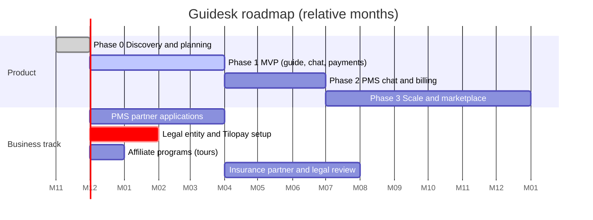

# Roadmap

> **Status:** Draft v0.3 · **Owner:** Founder · **Last updated:** 2026-11-24 ·
> **Related:** [PRD](prd.md) · [ADR-0003 integration strategy](../architecture/adr/0003-phased-channel-integration-strategy.md) · [Open questions](../open-questions.md)

Timelines are relative to the start of Phase 1 (M0). The founder works full time with AI coding
agents (confirmed 2026-11-14). The MVP start date is still open (OQ-02).

## Phase 0: Discovery and planning (current)

**Goal:** a shared, written understanding of the product, the market, and the technical
approach, ready for spec-driven development.

| Deliverable | Status |
|---|---|
| Discovery decisions (customer, market, revenue, channels, autonomy) | Done |
| Research: integrations, competitors, monetization partners, platform policies | Done |
| Vision, business model, personas, PRD, roadmap | Draft |
| Constitution (Spec Kit) | Draft v1.1.1 |
| Architecture overview and ADR-0001 to ADR-0009 | Draft. ADR-0001 to ADR-0009 accepted. |
| Security and performance architecture | Draft v0.1 |
| Open-questions log | Active |
| Spec Kit installed (`specify init`) | Done 2026-11-14 (v1.4.1.dev0, Claude Code skills) |
| First spec drafted (`/speckit-specify`) | Next |

**Exit criteria:** the founder approves the PRD prioritization (done 2026-11-14) and the ADRs
(done), and the critical open questions are answered (MVP date, design partners). The legal
entity must be decided early enough for payments in month 4.

## Phase 1: MVP, months 0–4

**Goal:** prove that hosts adopt the guide, that the agent resolves most guest questions
safely without any platform API, and that guests pay for add-ons.

**Milestones:**

- **End of month 3:** the pilot starts with every MVP feature except payments.
- **Month 4:** payments (F13) go live for pilot hosts. This needs the legal entity and a
  Tilopay merchant account with split settlement by week 10 (OQ-01, OQ-37).

| Scope (PRD IDs) | Notes |
|---|---|
| F01 Workspaces and accounts | Passwordless sign-in (Google, passkeys, email code); roles; invitations; users in several workspaces |
| F02 Property onboarding | Manual entry; pasted text or screenshots; CSV import; read-only PMS import (Beds24, Hostex; Hostaway if allowed); duplication; iCal stay windows |
| F03 Guide builder | Templates, editor, AI interview, document upload, ES/EN translation, shared workspace content, drafts from imports |
| F04 Guest guide | Mobile PWA, link and QR, gated sensitive information, disclosures |
| F05 In-guide AI chat | Grounded answers, escalation |
| F06 Host inbox and copilot | Draft approval, paste-to-reply copilot for OTA chats, notifications |
| F07 Agent settings | Autonomy per topic (default `draft`), escalation rules; workspace defaults with per-property overrides |
| F08 Add-on requests | Request and confirmation; payment through F13 from month 4 |
| F09 Tours affiliate | Viator and Civitatis links with disclosure |
| F10 Basic analytics | Questions, escalations, views, clicks |
| F11 Plan limits | Limits enforced; the pilot is free and billing comes after it |
| F13 Guest checkout and payouts | Month 4; hosted checkout, host payouts, refunds (needs OQ-01) |
| F22 Stay calendar and guest details | Added and built 2026-11-24 (spec 018): read-only calendar, stay view with the extras each stay bought, guest names typed by the host, the Airbnb reservation code from feeds |
| F11 AI reply allowances and top-ups | Added and built 2026-11-24 (spec 019): Pro at least 500 and Business at least 1,000 replies a month, Free 500 during the pilot, 25 messages per 10 minutes, founder-granted top-ups |

**Suggested build order (specs):**

1. Foundations: monorepo, CI, auth, tenancy, observability, eval harness
2. 001 Workspaces and accounts
3. 002 Property onboarding
4. 003 Guide builder
5. 004 Guest guide
6. 005 Guide chat agent
7. 007 Agent settings
8. 006 Host inbox and copilot
9. 009 Tours affiliate
10. 008 Service catalog
11. 010 Analytics
12. 013 Payments and checkout (month 4)
13. 014 Launch pages and demo workspace, 015 brand shell, 016 property photos, 017 desktop design
    (done 2026-11-19 to 2026-11-23)
14. 019 AI reply allowances and top-ups (small; before the pilot starts)
15. 018 Stay calendar and guest details

If the schedule slips, follow the cut order in [PRD §4](prd.md#4-feature-catalog-and-prioritization).

**Exit criteria and validation:**

- 10–20 individual hosts and 3–5 managers in the pilot, with real stays served.
- PRD pilot targets measured: activation, time to guide, automated resolution rate, accuracy,
  attach rate.
- Zero policy incidents.
- Every MVP security control in the [security architecture](../architecture/security.md#4-controls) in place before the first pilot guest.
- First add-on commissions collected through Guidesk checkout.
- A decision on pricing based on pilot evidence.

## Phase 2: In-platform chat and billing, months 4–7

**Goal:** the agent answers inside Airbnb, Booking.com, and Vrbo chats for hosts on supported
PMSs, and paid plans start.

| Scope | Dependency |
|---|---|
| F12 PMS integrations (in-platform chat and continuous sync): Hospitable and Hostaway first, then Guesty and Smoobu | Partner approvals (applied in Phase 0) |
| F21 Portfolio management: property groups, per-property permissions, owner read-only access | — |
| F06 extended: unified inbox across the platform chat and the guide chat | F12 |
| F11 Self-serve subscriptions (Free, Pro, Business), top-up purchase with an optional automatic top-up, and the plan review with pilot data (direction: AI replies only on Pro and Business) | Payment provider for hosts (OQ-13); top-up price (OQ-12) |
| Partner tour bookings on the stay (Localbird first) | A partnership where the partner reports bookings per stay (OQ-38) |
| F14 Reservations partners (car rental, transfers, restaurants) via affiliates | Partner programs |
| F15 Back-office (minimal) | — |

**Exit criteria:**

- At least one PMS integration live in production, with the agent replying in the OTA chat
  under host autonomy settings.
- Paid plans live.

## Phase 3: Scale and marketplace, months 7–13

| Scope | Notes |
|---|---|
| F17 In-platform chat for hosts without a PMS | Channex pilot or a Hospitable partnership. Weigh the 15.5% host-only fee impact. |
| F16 Embedded insurance | Licensed partner (for example Cover Genius or Vertical Insure) after legal review |
| F18 Local provider marketplace | Providers list their own services |
| F19 In-app tour booking | Viator Full+Booking or Merchant, or the GetYourGuide booking tier |
| F20 Public API and webhooks | Business plan |
| Portuguese (Brazil) | If the market decision confirms it |
| Quarterly re-check of OTA partner programs | Airbnb and Booking.com entry are currently closed or paused |
| Native host app (re-evaluation) | Only if the pilot hits the ADR-0006 triggers: missed escalations, mobile-heavy inbox friction, or manager demand |

## Business track (parallel to product)

| Workstream | Start | Owner | Notes |
|---|---|---|---|
| Apply to PMS partner programs (Hospitable, Hostaway, Guesty, Smoobu) | Phase 0 | Founder | Approval times are unknown; apply early |
| Confirm the terms for read-only imports with a customer's token (Beds24, Hostex, Hostaway) | Phase 0 | Founder | Decides the MVP importers (OQ-26) |
| Legal entity and Tilopay merchant account | Phase 0 | Founder | **Critical path:** needed by week 10 of the MVP for payments (F13). Tilopay is the initial provider (ADR-0007); confirm split settlement and coverage (OQ-37) |
| Join tour affiliate programs (Viator, Civitatis, GetYourGuide) | Phase 0 | Founder | Basic affiliate access is quick |
| Talk to Localbird about a tour partnership with bookings reported per stay | Phase 1 | Founder | OQ-38; Localbird is also a partial competitor through its guestbook |
| Recruit design partners | Phase 0 | Founder | Individual hosts and managers |
| Legal review: Airbnb policies, privacy, terms of service, insurance distribution | Phase 1 | Counsel | Before scaling upsells, and before insurance |
| Insurance partner negotiation | Phase 2 | Founder | — |
| External penetration test | Before public launch | Founder and vendor | SEC-19 |
