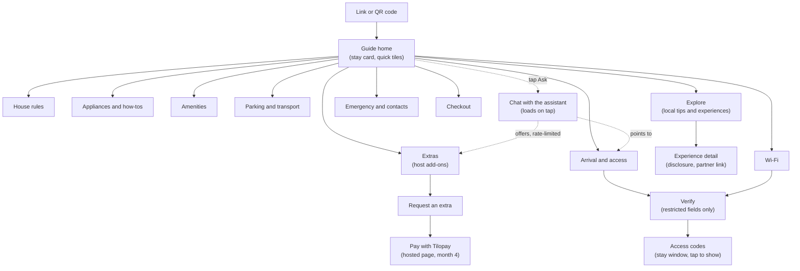
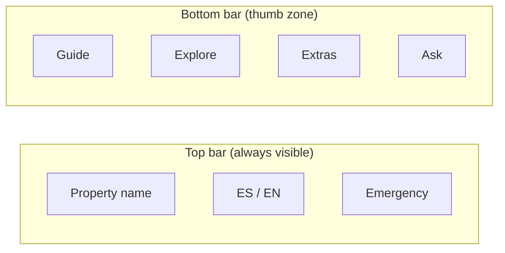
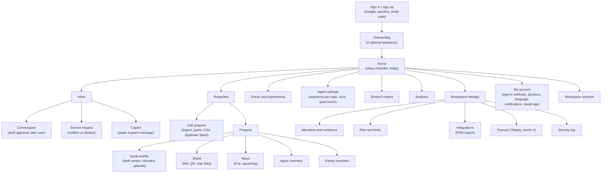
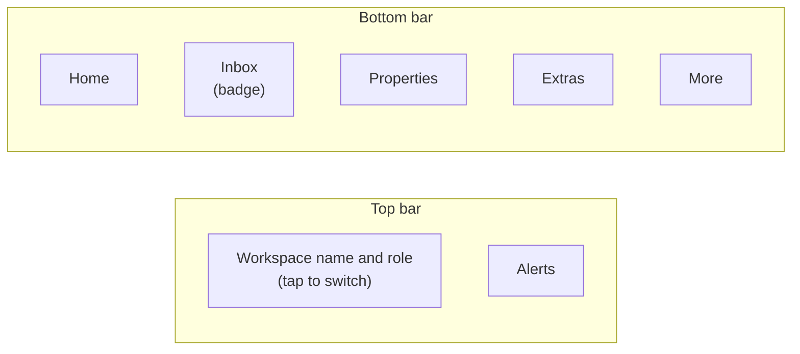

# Design Principles and Information Architecture

> **Status:** Draft v0.1 (provisional) · **Owner:** Founder · **Last updated:** 2026-11-14 ·
> **Related:** [UX index](README.md) · [Personas](../product/personas.md) · [PRD](../product/prd.md) · [Platform policies](../research/platform-policies.md) · [Security](../architecture/security.md) · [Performance](../architecture/performance.md) · [User flows](user-flows.md) · [Screens](screens.md)

This document turns the personas and the recorded constraints into design principles, then
defines the information architecture (IA) of the two products: the **guest guide** and the
**host portal**. It does not change any product, policy, or security decision. Where a decision
is still open, the IA shows a placeholder and names the open question.

## 1. Who we design for

| Persona | Device and context | What the design must give them |
|---|---|---|
| **P1 Ana**, individual host | Phone first, between other jobs; Spanish first | A complete guide in under 30 minutes from her phone; replies she can approve with one tap; no fear for her Airbnb account |
| **P2 Marco**, manager with 60 units | Phone and laptop; a team of 3 agents | Bulk setup, control over what the agent may do, a shared inbox that shows only what matters, and an audit trail |
| **P3 Emily**, guest | Phone on mobile data, at night, at the door; English; never installs anything | The door code and Wi-Fi in seconds, answers at midnight, and offers that never feel like pressure |
| **P4 Luis**, local provider (Phase 3) | Phone | Not designed in this version (F18 is Phase 3) |

## 2. Design principles

Each principle cites the constraint it comes from. When two principles conflict, the order
below decides: safety and compliance first, then speed for the guest, then everything else.

1. **The door comes first.** The guest's most urgent job is to get in. Arrival, Wi-Fi, and house
   rules are the first things on the guide home and must be readable within 5 seconds on slow
   3G ([performance §1](../architecture/performance.md#1-targets)). Everything else waits.
2. **Optional, never a gate.** The guide is a convenience, not a requirement. Nothing in the
   guide asks for an app, an account, a phone number, or an email address (PC-01, PC-02, PC-03).
   Every screen that holds essential information reminds the guest, in one line, that the same
   information is in their booking messages.
3. **Locked means locked.** Restricted values (door, alarm, and lockbox codes; Wi-Fi passwords the
   host marks as sensitive) appear only after verification, only inside the stay window, only on
   a deliberate tap, and never in offline storage (FR-04.4, SEC-01 to SEC-04). The interface makes
   the lock visible and explains it in plain words, so a locked field reads as protection, not as
   a broken page.
4. **Say who is talking.** Guests always know whether a message comes from the virtual assistant
   or from the host. Every answer from the assistant names the guide section it used (FR-05.2).
   When the assistant cannot answer, it says so and tells the guest what happens next (FR-05.3).
5. **Every offer shows its strings.** Any offer that earns the host or Guidesk money carries a
   visible disclosure at the point of offer, not behind a tap (PC-07, FR-04.6, FR-09.3). Offers
   are opt-in, rare, and never block access (PC-08, PRD §6.3).
6. **The host stays in control.** New workspaces start with the agent in `draft` mode
   (FR-07.1). The portal makes approving a draft a one-tap action, explains why the agent wrote
   what it wrote (FR-06.5), and suggests more autonomy only after the agent has earned it. The
   mandatory escalation categories are shown as locked settings, not hidden ones (FR-07.2).
7. **Phone first, for hosts too.** Every host workflow, from sign-up to approvals, works with one
   thumb on a phone (NFR-12). Desktop layouts add columns; they do not add features.
8. **Two languages, equal quality.** Spanish and English are both first-class (NFR-06,
   constitution IX). Layouts are designed for Spanish, which runs about 20–30% longer than English
   ([design system §7](design-system.md#7-internationalization)).
9. **Light by default.** The guide is static HTML from a CDN, with system fonts, no third-party
   widgets, and the chat loaded only when the guest taps it (≤ 100 KB initial JavaScript,
   [performance §2](../architecture/performance.md#2-guest-guide-delivery)). Design choices that
   need heavy scripts (carousels, embedded maps, custom fonts) are out.
10. **Accessible is the baseline.** WCAG 2.2 AA for every guest surface (NFR-07), and the same
    rules in the host portal.
11. **Draft before publish.** Imported, pasted, or AI-extracted content always lands as a draft
    for the host to review (FR-03.10). The interface never publishes on the host's behalf.
12. **Compliance is built into the words.** Templates, copilot drafts, and agent messages pass the
    same policy checks (PC-14). The interface explains a blocked draft in plain words and offers a
    compliant version instead of a dead end.

## 3. Guest guide: information architecture

### 3.1 Two ways in

The guide has two link types (SEC-01). The IA is the same; what changes is whether restricted
fields can unlock.

| Entry | How the guest gets it | What it can show |
|---|---|---|
| **Property link or QR code** | Scheduled message after booking confirmation (PC-05), or a QR code inside the property | Public sections only. Restricted fields show a lock with an explanation. |
| **Stay link** | Sent by the host for one stay; expires at checkout plus a short buffer | Public sections, plus restricted fields after verification inside the stay window |

The verification method is open (OQ-20). The wireframes assume a short code that the host shares
in the booking thread, because it works with either link type. This is a placeholder until
spec 004 decides.

### 3.2 Sitemap

**Section order** follows FR-03.1's default template. The host can hide empty sections; the
guest never sees an empty one. `Explore` merges the template's "Local recommendations" with the
affiliate experiences (F09), so the host's own tips always come first. `Extras` appears only when
the host offers add-ons (F08).

### 3.3 Navigation model (guest)

- **Top bar:** the property name, the language switch (FR-04.3), and an **Emergency** button
  that is always one tap away. Emergency information is the same in every view (WCAG 2.2,
  "Consistent help").
- **Bottom bar:** four destinations. `Extras` disappears when the host has no add-ons, leaving
  three. `Ask` opens the chat as a full-screen panel; the chat code loads at that moment, not
  before ([performance §2](../architecture/performance.md#2-guest-guide-delivery)).
- **Sections** open as full pages with a back button, so the browser's back gesture works as
  expected and each section has its own URL for the assistant to link to.
- **No hamburger menu.** Everything is visible on the home screen as tiles.
- **Offline:** pages already viewed stay readable (FR-04.2). Restricted fields and the chat show
  an offline state instead (SEC-04).

## 4. Host portal: information architecture

### 4.1 Sitemap

### 4.2 What each role sees

Per the permission matrix in [spec 001 FR-016](../../specs/001-workspace-accounts/spec.md#functional-requirements).
The portal hides what a role cannot use instead of showing disabled controls, except where a
locked control teaches something (for example, a restricted value an agent cannot reveal).

| Area | Owner | Admin | Agent |
|---|---|---|---|
| Inbox, conversations, copilot, draft approval | Yes | Yes | Yes |
| Properties and guides | Edit and publish | Edit and publish | View only, without restricted values (assumption) |
| Reveal restricted values | Yes, with re-authentication | Yes, with re-authentication | Never; the field says "Only owners and admins can view codes" |
| Extras, agent settings, shared content | Yes | Yes | No |
| Members and invitations | Yes | Yes (never the owner) | No |
| Plan, limits, and billing | Yes | No | No |
| Integrations, payouts | Yes | Yes (payout ownership to be confirmed in spec 013) | No |
| Security log | Yes | Yes | Own account events only |

### 4.3 Navigation model (host)

**Phone:**

- **Workspace switcher in the top bar** on every screen. The current workspace and role are
  always visible, and switching takes two taps (spec 001 FR-022).
- **Bottom bar, five items.** `Inbox` carries a badge with the number of items that need the
  host. `More` holds agent settings, shared content, analytics, workspace settings, and the
  account. Agents see three items: Inbox, Properties, More.
- **Copilot** is a primary button at the top of the inbox ("Paste a guest message") and a quick
  action on Home, because it is the main tool for hosts without a PMS in the MVP.
- **Notifications** deep-link to the exact conversation (FR-06.4). Opening one switches workspace
  first if needed, and says so.
- **Editors** (guide sections, extras) open full screen with a clear Save and a draft indicator.
- **Bottom sheets** hold short choices (role picker, property picker, workspace switcher), so they
  stay in thumb reach.

**Desktop (≥ 1024 px):** the bottom bar becomes a left sidebar with the same items, and the inbox
shows the list and the conversation side by side. No feature is desktop-only.

### 4.4 Home: the setup checklist

Home doubles as the onboarding guide until the first guest is served:

1. Create your first property (or import them).
2. Review and publish the guide draft.
3. Mark your access codes as sensitive.
4. Choose how the assistant replies (draft or auto, per topic).
5. Install Guidesk on your phone and test a notification (iPhone hosts: required for alerts,
   [ADR-0006](../architecture/adr/0006-web-first-pwa-no-native-apps.md)).
6. Add the guide link to your scheduled messages.

After that, Home shows "today": arrivals, items that need the host, and a short weekly summary
(F10).

## 5. Content model as the guest sees it

| Guide element | Source | Visible to |
|---|---|---|
| Section text, photos, short videos | Host, imports, AI drafts reviewed by the host | Anyone with the link |
| Shared blocks (policies, emergency contacts, checkout steps) | Workspace shared content, possibly overridden per property (FR-03.8) | Anyone with the link |
| Wi-Fi network name | Host | Anyone with the link |
| Wi-Fi password | Host; public or sensitive, the host chooses (FR-03.7) | Everyone if public; verified guests in the stay window if sensitive |
| Door, lockbox, and alarm codes | Host or import, encrypted (FR-03.9) | Verified guests in the stay window, after a tap |
| Stay card (dates, check-in and checkout times) | iCal or PMS stay | Stay link only |
| Extras and prices | Host catalog (F08) | Anyone with the link |
| Experiences | Affiliate partners, host can hide or pin (F09) | Anyone with the link |

## 6. Open items that affect the IA

- **OQ-20, verification method.** Changes the verify screen, not the sitemap.
- **OQ-28, offline arrival steps.** If approved, the access section gets a "Save until checkout"
  action; the default design has none.
- **Per-stay links without a PMS.** See [user flows §3](user-flows.md#3-guide-delivery-scheduled-message-link-and-qr)
  and the gaps listed in the [UX index](README.md#gaps-found-while-designing).
- **Brand (OQ-11).** Names, colors, and the logo in all diagrams and wireframes are placeholders.
