# User Flows

> **Status:** Draft v0.1 (provisional) · **Owner:** Founder · **Last updated:** 2026-11-14 ·
> **Related:** [UX index](README.md) · [Principles and IA](principles-and-ia.md) · [Screens](screens.md) · [Wireframes](wireframes.html) · [PRD](../product/prd.md) · [Architecture flows](../architecture/overview.md#5-key-flows) · [Spec 001](../../specs/001-workspace-accounts/spec.md)

Each flow has a diagram, a short narrative, and its key states. Screen IDs (for example `G-03`)
point to the [screen inventory](screens.md). The flows follow the PRD and the architecture
flows; where a decision is still open, the flow shows the assumption and names the open
question.

**State vocabulary used in every flow:**

| State | Meaning |
|---|---|
| **Empty** | Nothing to show yet; the screen explains why and offers the next step |
| **Loading** | Work in progress; skeletons shaped like the final content, never a blank page |
| **Error** | Something failed; plain words, what happened, what to do, and nothing lost |
| **Offline** | No connection; what still works, what does not, and the fallback |
| **Locked** | Exists but not available to this person or at this time, with the reason |
| **Limit** | A plan, rate, or safety limit was reached, with the reason and the way forward |

The examples use a fictional property: **Casa Colibrí**, a two-bedroom house in Playa Sámara,
Guanacaste, Costa Rica. The host is Ana (P1) and the guest is Emily (P3).

---

## 1. Host sign-up and onboarding

Source: [spec 001](../../specs/001-workspace-accounts/spec.md), user stories 1 and 2.

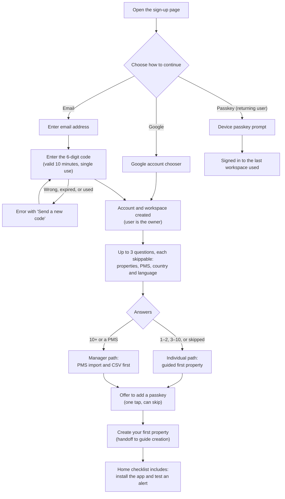

**Narrative.** Ana opens Guidesk on her phone and taps "Continue with email". She gets a
6-digit code, types or pastes it, and lands in her new workspace. Three short questions follow
(screen `A-04`); each has a visible "Skip". She chose "1–2 properties" and "No PMS", so Guidesk
takes her to the individual path: paste her listing text and get a draft guide. A one-tap offer
to add a passkey appears once. The iPhone install prompt is not a blocking screen: it is a step
in the Home checklist, so sign-up stays under the 2-minute target (spec 001 SC-001) while still
happening during onboarding (NFR-12, ADR-0006).

**Assumptions:**

- "3–10 properties" goes to the individual path, with the bulk options shown as a second
  choice. Spec 001 only defines the "1–2" and "10+ with a PMS" cases.
- A passkey is offered as a sign-in method for returning users and after the first sign-in
  (FR-008). Creating a brand-new account still verifies an email by code or by Google (FR-002).

**Key states:**

| State | Behavior |
|---|---|
| Loading | Creating the workspace shows a short progress line, never a blank screen. |
| Error | Wrong or expired code: "That code didn't work. Codes last 10 minutes." with "Send a new code". Google cancelled: back to the method choice, nothing lost. |
| Limit | Too many attempts: "Too many tries. Try again in a few minutes." The account owner is notified (AC-SEC-001). Resend has a cooldown timer (AC-SEC-008). |
| Neutral messages | "If this address can receive email, we've sent a code." The same text whether or not an account exists (AC-SEC-007). |
| Offline | Sign-in needs a connection; the email field keeps what was typed. |
| Locked | An owner or admin of a workspace with more than 2 properties must add a second factor before sensitive actions (FR-009). The prompt explains why: "Your account can open guests' doors." |

---

## 2. Guide creation

Source: PRD F02 and F03, [architecture flow 5.4](../architecture/overview.md#54-guide-drafts-from-a-pms-import-mvp-read-only).

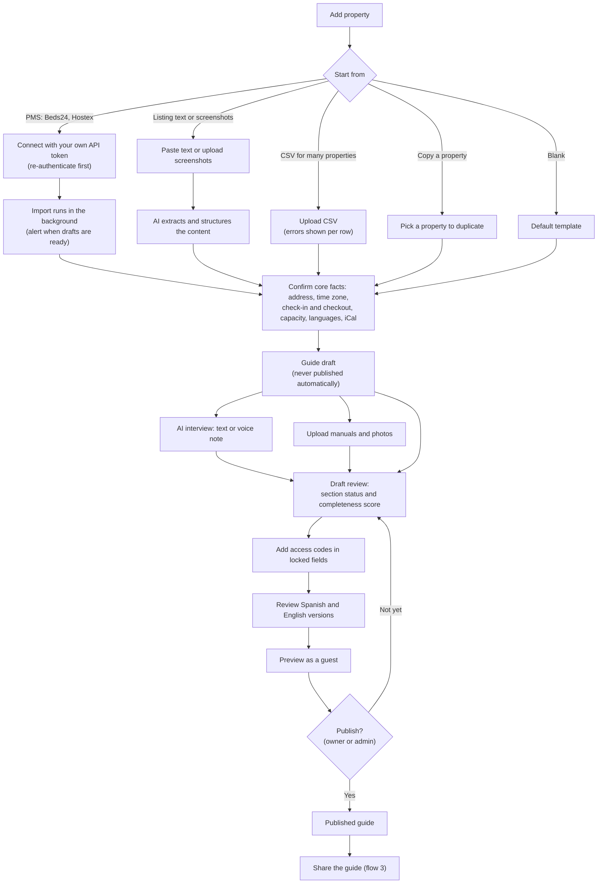

**Narrative.** Ana pastes the description, house rules, and amenities from her Airbnb listing
and adds two screenshots. Guidesk never fetches the listing page itself (FR-02.2, PC-12). A few
seconds later she sees the draft review (screen `H-12`): nine sections, each marked Ready, Needs
review, or Missing, and a completeness score of 64%. The score lists what guests ask about most
and the draft lacks: how the air conditioning works, where to park, and a photo of the lockbox
(FR-03.6, FR-03.10). She taps "Fill gaps with the interview" and answers by voice while walking
(FR-03.3). The interview asks one question at a time and writes the answers into the right
sections. The door code goes into a **locked field** with a masked input, never into the
interview. She checks the English version, previews the guide as a guest, and publishes.

Marco follows the manager path: he connects Beds24 with his own token (after re-authenticating,
FR-011), and 40 drafts arrive in the background. Shared content such as his company's checkout
rules and emergency contacts is filled in once and inherited by every property (FR-03.8).

**Design rules for this flow:**

- **Codes stay out of AI inputs.** The interview and the paste box say, in place: "Don't type
  door codes here. Add them in the locked fields." Codes are entered only in locked fields,
  which are masked and never sent to the AI (FR-03.9, constitution VI). See the gap on host-typed
  codes in the [UX index](README.md#gaps-found-while-designing).
- **Imports are drafts.** Imported and extracted text is labeled "From your listing" or "From
  Beds24" until the host edits or approves it.
- **Translations are visible.** Each section shows "English: machine translation" until the host
  reviews it (FR-03.5).
- **Benefits are declared.** When a host adds a local recommendation, the form asks "Do you get
  a commission, discount, or other benefit from this business?" A "yes" adds the disclosure to
  the guest view automatically (PC-07).
- **Publishing is explicit.** Pre-publish checks warn about missing essentials (arrival steps,
  emergency contacts, unmarked codes) but only the host presses Publish.

**Key states:**

| State | Behavior |
|---|---|
| Empty | No properties yet: the five starting options, with the recommended one first for the host's path. |
| Loading | PMS import: "Importing 12 of 40 properties. You can leave this page; we'll notify you." Extraction and drafting show skeleton sections filling in. Voice notes show "Transcribing…". |
| Error | Invalid token: what to check, with a link to the provider's help. Partial import: "38 imported, 2 need attention" with reasons. CSV: a per-row error table and a downloadable error file. File rejected: the reason (type, size, or failed safety scan). Unreadable screenshot: "Paste the text instead." Drafting timeout: the partial draft is kept, with "Try again". |
| Offline | Text typed offline stays on the device and saves when the connection returns. Publish, imports, uploads, and locked fields are disabled offline. |
| Limit | Free plan at 2 properties: explains the limit. During the free pilot, Guidesk sets the limits (FR-11.2). |
| Locked | Agents see guides read-only and cannot open locked fields. |

---

## 3. Guide delivery: scheduled message, link, and QR

Source: [ADR-0003](../architecture/adr/0003-phased-channel-integration-strategy.md) (MVP), PC-01, PC-05, SEC-01.

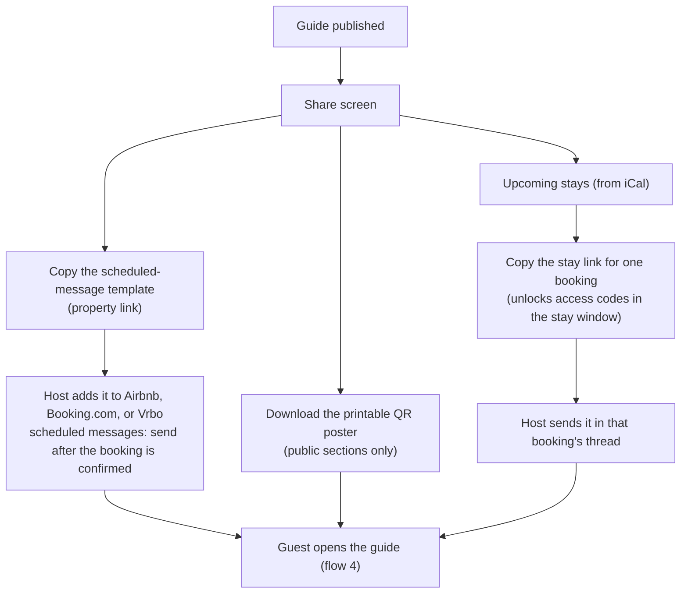

**Narrative.** After publishing, Ana sees the Share screen (`H-16`) with three cards:

1. **For every booking:** a ready-made message in Spanish and English with the property link,
   and plain steps to add it to her platform's scheduled messages, set to send after the booking
   is confirmed. Pre-booking messages never carry links (PC-05).
2. **For the property:** a printable QR poster. It opens the public guide only; the poster says
   so, and it never shows codes (SEC-01).
3. **For one stay:** the list of upcoming stays from her iCal feed, each with "Copy stay link".
   This link unlocks the access codes during that stay only.

A reminder sits on the screen: "Keep your check-in instructions in your platform messages too.
The guide is optional for guests" (PC-01, PC-02).

**Assumption to confirm.** OTA scheduled messages send the same text to every booking, so they
can carry only the property link. A stay link has to be copied once per booking, unless the
verification method (OQ-20) can unlock codes from the property link. This is listed as a gap in
the [UX index](README.md#gaps-found-while-designing).

**Key states:**

| State | Behavior |
|---|---|
| Empty | No calendar connected: "Connect your calendar so guests can see access codes during their stay," with a short how-to for each platform's export link, or "Add a stay by hand". |
| Loading | Calendar sync shows "Last synced 10 minutes ago" and a refresh action. |
| Error | Calendar link cannot be read: plain explanation and how to get a new export link. |
| Changed stay | A stay that disappears from the calendar marks its stay link as inactive (proposal; spec 004 confirms). The host can revoke any stay link by hand (SEC-01). |
| Offline | Copy and the QR download work from cached data; sync waits for the connection. |

---

## 4. Guest opens the guide, verifies, and reveals the door code

Source: FR-04.1 to FR-04.5, [architecture flow 5.3](../architecture/overview.md#53-revealing-sensitive-information), SEC-01 to SEC-04.

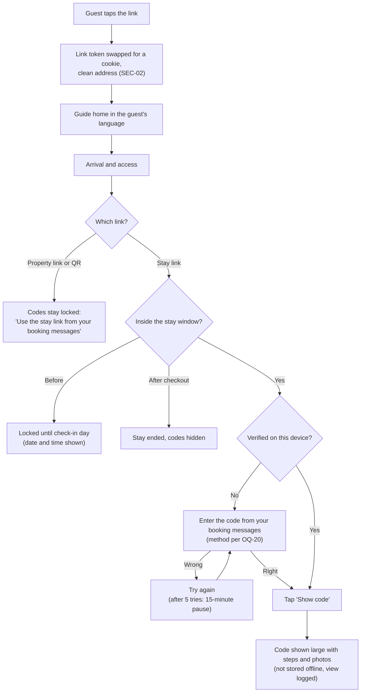

**Narrative.** Emily arrives in Sámara at 9:40 pm on mobile data. She opens the stay link from
her Airbnb messages. The guide opens in English, because her phone is in English (FR-04.3). The
home screen (`G-01`) shows her stay card and the first tiles: Arrival, Wi-Fi, House rules. She
taps Arrival: step-by-step directions with photos of the gate and the lockbox. The lockbox code
shows a lock: "Enter the 6-character code from your booking messages to show it" (`G-04`). She
pastes the code, taps "Show code", and sees **2 7 0 4** in large digits, with a copy button
(`G-05`). Her host can see that the code was viewed (SEC-16), and the screen says so in one
line.

**Design rules for this flow:**

- The code appears only after a deliberate tap, even for a verified guest, so it is not on
  screen by accident.
- Screen readers read the code digit by digit.
- Text loads first; photos load after, at reserved sizes (CLS ≤ 0.1).
- Every locked state repeats the fallback: "Your access details are also in your booking
  messages."
- Times show in the property's time zone. When the phone's time zone differs, both appear.

**Key states:**

| State | Behavior |
|---|---|
| Loading | "Show code" turns into "Showing…" on the button itself; the rest of the page stays usable. |
| Error | "We couldn't load the code. Try again." plus the booking-messages fallback. |
| Offline | Arrival steps already viewed stay readable, but the code shows "Connect to the internet to show the code" (SEC-04). A "Save until checkout" action appears only if OQ-28 allows it. |
| Locked | Property link: "Codes appear only with your stay link." Before the window: "Available from Fri 12 Dec, 3:00 pm (Sámara time)." After checkout: "Your stay has ended." |
| Limit | After 5 wrong codes: "Too many tries. Try again in 15 minutes," with a countdown, and the host is alerted (SEC-03). |
| Expired | A revoked or expired stay link opens the public guide with a short note: "This stay link has ended." |

---

## 5. Guest chat with the agent, including escalation and the holding reply

Source: FR-05.1 to FR-05.6, PRD §6, [architecture flow 5.1](../architecture/overview.md#51-guest-asks-a-question-in-the-guide-chat-mvp), SEC-07.

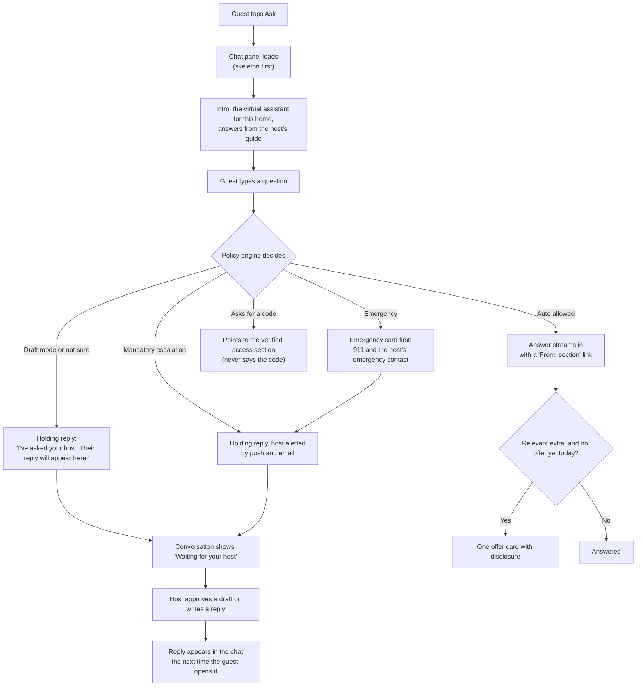

**Narrative.** At 11 pm Emily taps Ask (`G-06`). The chat code loads only now, so the guide
stayed light. The intro says who she is talking to: "I'm the virtual assistant for Casa Colibrí.
I answer from Ana's guide. In an emergency, call 911." Suggested questions appear as chips.

- She asks for the Wi-Fi password. Ana marked it as sensitive, and the assistant never handles
  sensitive values (constitution VI), so it replies: "The Wi-Fi password is in the Wi-Fi section
  for verified guests," with a link to that section.
- She asks how the bedroom air conditioning works. Ana set "Appliances" to `auto`, so the answer
  streams in, with "From: Appliances and how-tos" below it (FR-05.2).
- She writes that the bedroom AC is leaking water. That is a malfunction (PRD §6.2), so the
  policy engine escalates. Emily gets a holding reply within 2 seconds: "I've let Ana know.
  She'll reply here as soon as she can. If water is near outlets, turn off the AC at the switch
  by the door." The last sentence appears only if the guide contains it. Ana's phone gets a push
  alert with a deep link.

**Design rules for this flow:**

- **Who is speaking:** assistant messages have an "Assistant" label; host messages show the
  host's name and a "Host" label.
- **The draft default is visible.** With autonomy at `draft` (the default, FR-07.1), most first
  questions get a holding reply. The holding text sets expectations and reminds the guest that
  the platform's chat also reaches the host.
- **Emergencies:** the emergency card, with tap-to-call buttons, appears before any text
  (PRD §6.2).
- **Offers:** at most one unsolicited offer per conversation per day, never after a decline, and
  always with the disclosure (PRD §6.3). No offers during an escalation.
- **Streaming and screen readers:** the reply is announced once it is complete, not token by
  token (WCAG 4.1.3).

**Key states:**

| State | Behavior |
|---|---|
| Empty | Intro plus 3–4 suggested questions drawn from the guide's sections. |
| Loading | Typing indicator "Assistant is writing…" until the first words arrive (target ≤ 3 s, NFR-01). |
| Error | AI unavailable or slow: the holding reply goes out, the host is alerted, and the guide keeps working (degraded mode, [performance §7](../architecture/performance.md#7-resilience-and-degraded-modes)). Send failed: the message stays in the input with "Try again". |
| Offline | Input disabled: "You're offline. Your messages can't be sent right now. Your host is also reachable in your booking messages." Earlier messages stay visible. |
| Limit | Message cap: a counter appears near 2,000 characters. Rate limit (20 messages in 10 minutes): a holding reply, the host is notified, and the input pauses with an explanation (SEC-07). |
| Quiet hours | Non-urgent holding replies say when the host usually answers; emergencies still alert (FR-07.3). |

---

## 6. Host inbox, draft approval, and the paste-to-reply copilot

Source: FR-06.1 to FR-06.5, FR-07, PC-14.

### 6.1 Inbox and draft approval

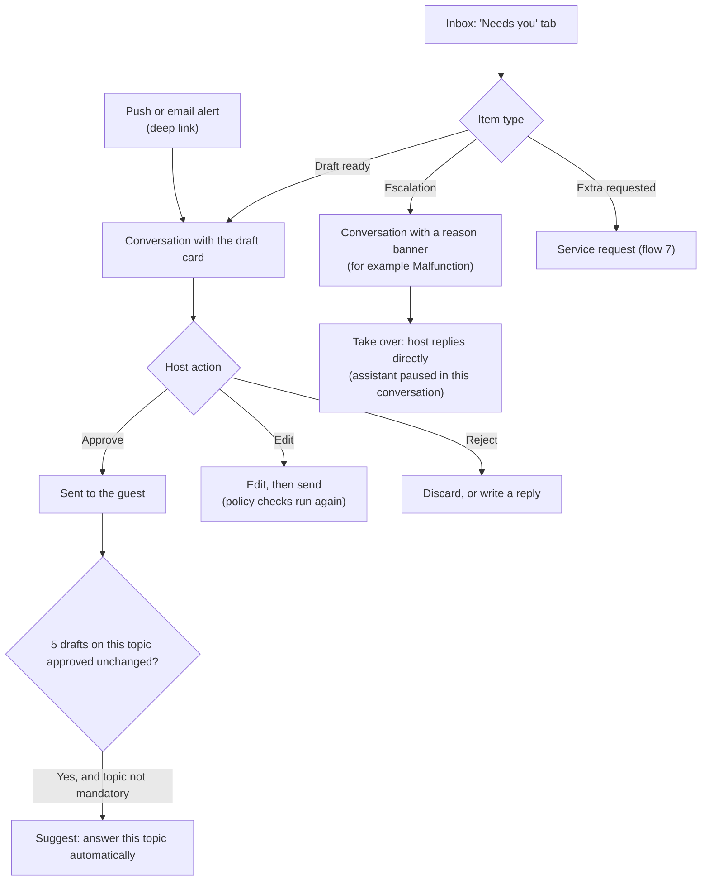

**Narrative.** Ana's inbox (`H-20`) opens on "Needs you". The top item is Emily's escalation,
marked "Malfunction". Below it, a draft is ready for another guest's question about parking. The
draft card (`H-21`) shows the proposed reply, the guide section it used, and a "Why this reply"
link with the topic, the autonomy setting, and the checks it passed (FR-06.5). Ana taps
Approve. After she has approved five parking drafts without changes, the inbox suggests letting
the assistant answer parking questions on its own. Mandatory categories such as emergencies and
refunds never get this suggestion; their settings show a lock (FR-07.2).

Guests in the guide chat have no name or contact data (PC-03), so conversations are labeled by
property and stay: "Casa Colibrí · 12–19 Dec · Guide chat".

**Assumptions:**

- An approved draft appears to the guest as an assistant message. A reply written or rewritten
  by the host appears as the host's message.
- The "5 unchanged approvals" threshold is a starting value for the trust ladder, to tune in the
  pilot.

### 6.2 Paste-to-reply copilot

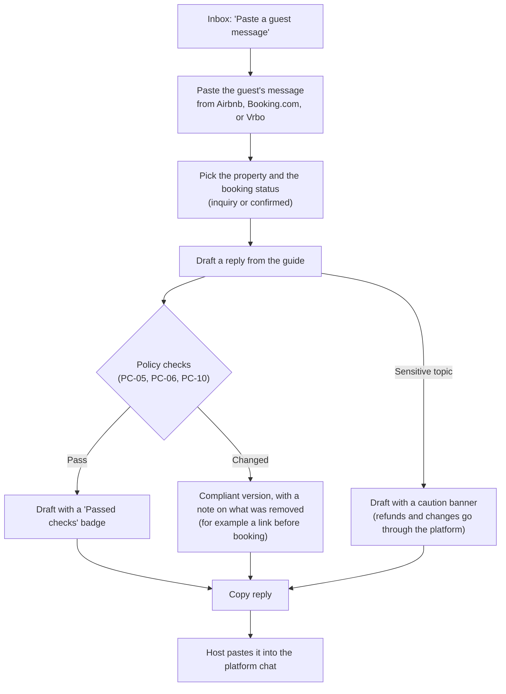

**Narrative.** A guest asks Ana in Airbnb whether they can bring a dog. She opens the copilot
(`H-22`), pastes the message, picks Casa Colibrí and "Confirmed booking", and gets a draft
grounded in her house rules. The badge says "Passed checks". She copies it back to Airbnb. For an
inquiry (before booking), the copilot removes any link and says why (PC-05). The booking-status
choice exists because the rules differ before and after confirmation.

**Key states (inbox and copilot):**

| State | Behavior |
|---|---|
| Empty | "You're all caught up." When no guide is shared yet: "Share your guide to start receiving questions." |
| Loading | Skeleton list; drafts in progress show "Assistant is drafting…". |
| Error | Sending failed: the message stays, with "Try again". The copilot keeps the pasted text if drafting fails. |
| Offline | The last loaded inbox stays readable with an offline banner; approve, send, and copilot are disabled. |
| Alerts off | A banner explains that alerts are off, with the steps to turn them on; email still arrives (ADR-0006). |
| Team | When another member is replying in a conversation, it shows "Marta is replying" (assumption, for Marco's team). |

---

## 7. Add-on request, host confirmation, and Tilopay hosted checkout

Source: FR-08.1 to FR-08.3, FR-13.1 to FR-13.6, [ADR-0007](../architecture/adr/0007-tilopay-initial-payment-provider.md), SEC-21.

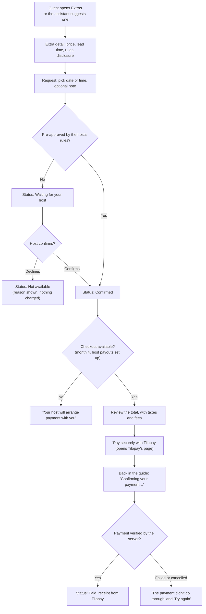

**Narrative.** Emily wants an airport pickup from Liberia for her friends who arrive on Friday.
In Extras (`G-08`) she opens "Airport pickup from Liberia (LIR)", $85, and reads "Offered by your
host. Guidesk receives a service fee." She picks Friday at 4:30 pm and taps Request. Ana gets an
alert, opens the request in her inbox (`H-23`), and confirms. When Emily opens the guide again,
the extra says Confirmed and shows the total with taxes and fees (`G-09`, FR-13.4). She taps "Pay
securely with Tilopay", pays on Tilopay's page, and returns to "Confirming your payment…". The
order turns Paid only after the server verifies the payment with Tilopay, never from the
redirect alone (SEC-21).

**Design rules for this flow:**

- Card data is entered only on Tilopay's page. The guide never shows card fields (SEC-21).
- Nothing is charged before the host confirms, unless the host's rules pre-approve the extra
  (FR-13.2).
- Extras never change the reservation (dates, nights, guests) and never include fees that are
  mandatory for the stay (FR-13.6, PC-06). Early check-in and late checkout are sold through
  checkout only after the legal review confirms it (OQ-35). The wireframe uses an airport pickup
  for that reason.
- The guide asks for no contact data. Tilopay's page may ask for what the payment needs
  (FR-13.4, OQ-35).
- Before checkout goes live (pilot months 3–4) and for hosts without payouts, the request flow
  still works, and the host collects payment with the guest's agreement (FR-08.2).

**Key states:**

| State | Behavior |
|---|---|
| Empty | No extras: the Extras tab is hidden. |
| Loading | "Confirming your payment…". After 30 seconds: "This can take a minute. You can close this page; the status will update here." |
| Error | Payment failed or cancelled: nothing charged, with "Try again". Host declined: the reason and "nothing was charged". |
| Expired | A request the host has not answered before the lead time passes expires, and nothing is charged (assumption, spec 008). |
| Offline | Request and Pay are disabled with an explanation; the status shown is the last one loaded. |
| Refunded | "Refunded $85 on 14 Dec." Refunds are started by the host, with re-authentication (FR-13.5). |

---

## 8. Tour affiliate click with disclosure

Source: FR-09.1 to FR-09.3, PC-07, PC-10.

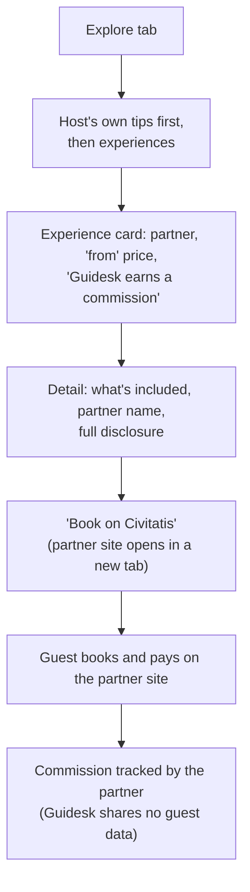

**Narrative.** In Explore (`G-07`), Ana's own tips come first: her favorite sunset spot and a
soda (a small local restaurant) in town. Below them, "Experiences near Sámara" lists a waterfall
and canopy tour "from $79" by a partner. Each card shows "Guidesk earns a commission if you book"
in plain view (PC-07). The detail screen names the partner and repeats the disclosure next to the
button. "Book on Civitatis" opens the partner site in a new tab, and the guide's link token never
travels with it (SEC-02).

**Design rules for this flow:**

- Disclosure text depends on who benefits: "Guidesk earns a commission" or, if hosts get a share
  (OQ-08), "Your host and Guidesk earn a commission".
- Hosts can hide categories and pin their own recommendations (FR-09.2).
- The assistant may mention an experience when the guest asks, or once a day unprompted, with the
  same card and disclosure (PRD §6.3). The guide chat is the only place for unsolicited offers;
  in OTA threads (Phase 2) the agent only answers questions (PC-10).
- Affiliate offers are plain links, not embedded widgets ([performance §2](../architecture/performance.md#2-guest-guide-delivery)).

**Key states:**

| State | Behavior |
|---|---|
| Empty | No experiences nearby, or all hidden: Explore shows only the host's tips; with none, the tab is hidden. |
| Loading | Cards render from the published guide; images load lazily at reserved sizes. |
| Offline | Cards stay visible; "Book" says it needs a connection. |

---

## 9. Team invitation and workspace switching

Source: [spec 001](../../specs/001-workspace-accounts/spec.md), user stories 3 and 4.

### 9.1 Invitation

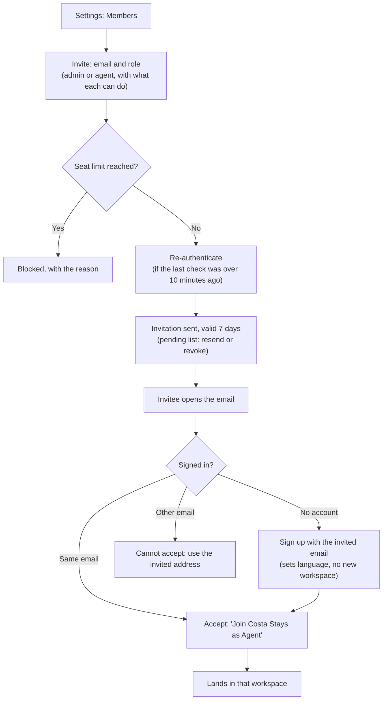

**Narrative.** Marco invites Marta as an agent (`H-31`). The role picker explains each role in
one line, including "Agents never see door codes" (spec 001 FR-016). Guidesk asks Marco to
confirm it is him, because inviting is a sensitive action (FR-011). Marta opens the email, signs
up with that address, and lands in Marco's workspace with no workspace of her own created
(FR-020).

### 9.2 Workspace switching

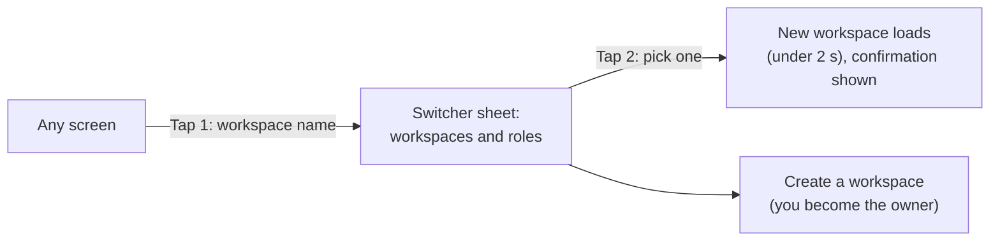

**Narrative.** Luisa is a co-host for two managers and owns one apartment. The top bar always
shows her current workspace and role. She taps it, sees her three workspaces with their roles
(`H-30`), and picks another one. Every screen now shows only that workspace's data (FR-022,
SC-007). Next time she signs in, she lands in the last workspace she used (FR-024).

**Key states:**

| State | Behavior |
|---|---|
| Error | Expired or used invitation: "This invitation has expired. Ask Marco for a new one." Already a member: the inviter is told before sending. |
| Locked | Wrong account: the invitee sees only the workspace name and the instruction to use the invited address (AC-SEC-002). |
| Limit | Seat limit: invitation blocked with an explanation (FR-021). Resend is rate-limited (AC-SEC-008). |
| Removed | A removed member sees "You no longer have access to this workspace" at the next action, within 1 minute (FR-025). Someone removed from their only workspace is offered to create one. |
| Deep link | An alert from another workspace switches workspace first and shows "Switched to Marco's Vacation Homes". |
| Offline | The switcher lists workspaces but switching needs a connection. |
