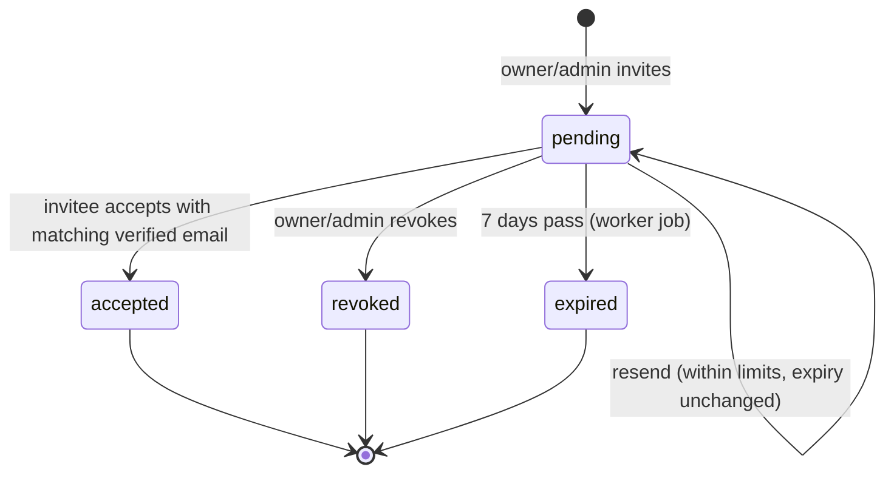
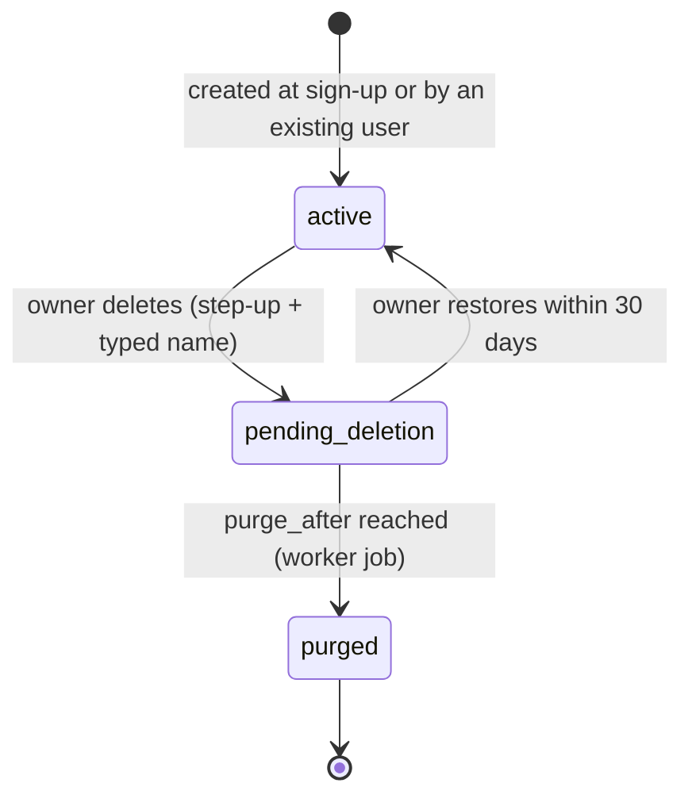

# Data Model: Workspaces, Accounts, Roles and Invitations

**Feature**: [spec.md](spec.md) · **Plan**: [plan.md](plan.md) · **Decisions**: [research.md](research.md)

Conventions:

- IDs are UUIDv7.
- Timestamps are `timestamptz` in UTC.
- Emails are stored normalized (trimmed, lowercased) for comparison (FR-003).
- **Tenant tables** carry `workspace_id`, with RLS enabled and forced.
- **User-scoped tables** use `user_id = current_setting('app.user_id')` policies.

## 1. Identity (managed by the auth library, global)

Better Auth creates and owns these tables. Their exact columns follow the library version
pinned in implementation. Guidesk reads them only through `AuthProviderPort`.

| Table | Purpose | Guidesk additions |
|---|---|---|
| `user` | One row per person (FR-003) | `preferred_language` (`es` or `en`), `is_staff` (bool), `last_workspace_id` (nullable), `deleted_at`, `purge_after` |
| `session` | Signed-in devices (FR-013) | `device_id_hash`, `device_label` (browser and OS), `approx_location` (city, country) |
| `account` | Linked sign-in methods (Google) | None |
| `verification` | One-time codes and email verification (FR-002) | None. Codes expire after 10 minutes and work once |
| `passkey` | Registered passkeys (FR-008) | None |
| `two_factor` | Authenticator-app secret and backup codes (FR-009, FR-010) | None. Secrets are encrypted by the library |

No password columns are used: password sign-in is disabled.

## 2. Guidesk account tables (user-scoped)

### `onboarding_profile`

| Field | Type | Rules |
|---|---|---|
| `user_id` | uuid, PK, FK → user | One per user |
| `properties_bucket` | enum `1_2`, `3_10`, `10_plus`, nullable | Optional (FR-005) |
| `pms` | enum of supported PMSs plus `none` and `other`, nullable | Optional |
| `pms_other` | text ≤ 80, nullable | Only when `pms = other` |
| `country` | ISO 3166-1 alpha-2, nullable | Optional |
| `path` | enum `individual`, `manager` | Derived: `manager` when the bucket is `10_plus` or `3_10` with a PMS; otherwise `individual` (FR-006) |
| `answered_at`, `updated_at` | timestamptz | — |

The data class is Internal. Reporting to Guidesk is aggregate only (SEC-20).

### `known_device`

| Field | Type | Rules |
|---|---|---|
| `id` | uuid, PK | — |
| `user_id` | uuid, FK → user | — |
| `device_id_hash` | text | Hash of the random device cookie; unique per user |
| `label` | text | Browser and OS, for display |
| `first_seen_at`, `last_seen_at` | timestamptz | A sign-in with an unknown hash triggers the new-device alert (FR-012) |

### `session_assurance`

| Field | Type | Rules |
|---|---|---|
| `session_id` | PK, FK → session | One per session |
| `strong_auth_at` | timestamptz, nullable | Set by re-authentication (R5) |
| `method` | enum `passkey`, `totp`, `email_otp` | Method used for the latest step-up |
| `mfa_satisfied` | bool | True after a passkey sign-in or a second-factor check (R6) |

### `step_up_challenge`, `auth_lockout`, and `used_totp_code` (added in implementation)

- `step_up_challenge`: email step-up codes per session.
  - Fields: an HMAC of the code, the expiry (10 minutes), attempts, and when it was consumed.
  - Only the newest code of a session works.
- `auth_lockout`: failure counters and temporary locks (AC-SEC-001).
  - The key is a hashed email or a user ID, so no raw emails are stored.
  - 5 failures in 15 minutes lock it for 15 minutes.
- `used_totp_code` (added in the security review, T103): a hash of each accepted authenticator
  code per user, kept for 2 minutes, so a code works only once.
- All three are system-only: `guidesk_app` has no access.

### `account_deletion_request`

| Field | Type | Rules |
|---|---|---|
| `user_id` | text, PK, no foreign key | The user's ID until the purge, then the account's random `deleted:` pseudonym, so the completion record can't be linked back (security review T103) |
| `requested_at`, `purge_after` | timestamptz | `purge_after` = requested + 30 days (FR-028) |
| `status` | enum `scheduled`, `completed`, `cancelled` | Signing in again cancels; the worker completes it with `purge_account()` |

### `email_change_request` (added in implementation)

One pending change per user: the new address, an HMAC of the 6-digit code, the 10-minute expiry,
and the attempts (at most 5). System-only.

### Privileges of `guidesk_app` (security review T103)

Request handlers run as `guidesk_app`. Since migration `0008_least_privilege` it can only:

- read workspaces it belongs to, and rename one (owner and admin);
- read memberships;
- read and write its own onboarding answers;
- read security events through the parent table, where RLS applies (never partitions);
- read `user` display fields: its own row and, for owners and admins, the current workspace's
  members (RLS on `user`).

New tables get no default grants. Each migration grants what request handlers need, and the CI
check `pnpm lint:rls` fails on any table `guidesk_app` can reach without forced RLS.

## 3. Tenancy tables (tenant-owned, RLS forced)

### `workspace`

| Field | Type | Rules |
|---|---|---|
| `id` | uuid, PK | This is the `workspace_id` for the row itself |
| `name` | text, 1–80 characters | Defaults from the creator's name (FR-004) |
| `created_by` | text, nullable, FK → user (`ON DELETE SET NULL`) | History only; cleared when that account is purged |
| `status` | enum `active`, `pending_deletion` | — |
| `deleted_at`, `purge_after` | timestamptz, nullable | Set on deletion; `purge_after` = +30 days (FR-027) |
| `seat_limit` | int, nullable, > 0 | Pilot seat limit set by Guidesk; null uses the default of 10 (FR-021, until feature 011) |
| `created_at`, `updated_at` | timestamptz | — |

**RLS:** visible when a `membership` row exists for `(id, app.user_id)`. Updates are limited to
the owner and admins; deletion and restore to the owner. Rows in `pending_deletion` are visible
only to the owner (for restore).

### `membership`

| Field | Type | Rules |
|---|---|---|
| `id` | uuid, PK | — |
| `workspace_id` | uuid, FK → workspace | — |
| `user_id` | uuid, FK → user | Unique with `workspace_id` |
| `role` | enum `owner`, `admin`, `agent` | Partial unique index: exactly one `owner` per workspace; a deferred check prevents zero owners |
| `invited_by` | uuid, nullable | — |
| `created_at`, `updated_at` | timestamptz | — |

**RLS:**

- A user sees their own memberships.
- Owners and admins see every membership in their workspaces.
- Role changes and removals are limited to the owner and admins, and never target the
  `owner` row (FR-016, FR-025, AC-SEC-003).

### `invitation`

| Field | Type | Rules |
|---|---|---|
| `id` | uuid, PK | — |
| `workspace_id` | uuid, FK → workspace | — |
| `email` | text, normalized | Unique among `pending` invitations per workspace |
| `role` | enum `admin`, `agent` | Never `owner` |
| `token_hash` | text, unique | SHA-256 of a 256-bit random token; the token appears only in the email link. A resend replaces it |
| `status` | enum `pending`, `accepted`, `revoked`, `expired` | See the state machine |
| `invited_by` | uuid, FK → user | — |
| `expires_at` | timestamptz | Created + 7 days (FR-018) |
| `send_count`, `last_sent_at` | int, timestamptz | Resend limits (R8) |
| `accepted_by`, `accepted_at` | uuid, timestamptz, nullable | — |
| `created_at` | timestamptz | — |

**RLS:** owners and admins of the current workspace can read, create, resend, and revoke
(`guidesk_app` may update only `status`, `token_hash`, `send_count`, and `last_sent_at`, and can
never set `accepted`). Acceptance goes only through the
`accept_invitation(token_hash, user_id)` `SECURITY DEFINER` function (R4, migration
`0011_invitations_rls`):

- the user must be the signed-in user (`app.user_id`);
- an unknown, used, revoked, or expired token, or a workspace that is not active, raises `GD410`;
- a verified email that differs from the invited one raises `GD403` and leaves the invitation
  open;
- it inserts the membership, marks the invitation accepted, sets the user's last workspace, and
  writes `invitation.accepted`, all in one transaction. Accepting again as a member returns
  `already_member`. The public lookup
returns only the workspace name, the inviter's display name, the role, and the status
(AC-SEC-002).

### `idempotency_key` (added in implementation)

System-only table for retried POSTs (`Idempotency-Key`): the user, the key, the route, and the
stored status and body. Keys expire after a day; the worker prunes them daily.

## 4. Security log (append-only)

### `security_event`

The table is partitioned by month. The application role has `INSERT` and `SELECT` only, and a
trigger rejects `UPDATE` and `DELETE` (R11).

| Field | Type | Rules |
|---|---|---|
| `id` | uuid | — |
| `occurred_at` | timestamptz | Partition key |
| `type` | enum (catalog below) | — |
| `outcome` | enum `success`, `failure`, `denied` | — |
| `actor_user_id` | uuid, nullable | Pseudonymized when the account is purged |
| `workspace_id` | uuid, nullable | Null for account-level events |
| `target_type`, `target_id` | text, uuid, nullable | For example `membership` and its ID |
| `ip_hash` | text | Salted hash; no raw IP |
| `approx_location` | text, nullable | City and country |
| `user_agent_family` | text, nullable | — |
| `metadata` | jsonb | Non-secret details only (for example old and new role). Never codes or tokens |

**RLS:** owners and admins read their workspace's events. Every user reads their own
account-level events (`workspace_id` is null and `actor_user_id` is the user).

**Event catalog (FR-030):**

| Group | Types |
|---|---|
| Sign-in | `signin.succeeded`, `signin.failed`, `signin.locked`, `signin.new_device` |
| Factors | `passkey.added`, `passkey.removed`, `mfa.enrolled`, `mfa.removed`, `recovery_code.used`, `step_up.succeeded`, `step_up.failed` |
| Sessions | `session.revoked`, `sessions.revoked_all` |
| Account | `email.change_requested`, `email.changed`, `account.export_downloaded`, `account.deletion_scheduled`, `account.deletion_cancelled`, `account.deleted` |
| Invitations | `invitation.sent`, `invitation.resent`, `invitation.accepted`, `invitation.revoked`, `invitation.accept_denied` |
| Membership | `member.role_changed`, `member.removed`, `member.left`, `ownership.transferred` |
| Workspace | `workspace.created`, `workspace.deletion_scheduled`, `workspace.restored`, `workspace.purged` |
| Access | `access.cross_workspace_denied` (logged in the workspace that owns the ID), `access.role_denied` (a role lacks the capability, AC-SEC-003), `restricted_value.reveal_denied` (agent role, AC-SEC-009) |

## 5. State machines

### Invitation

The database enforces the request-side transitions (migration 0015): `guidesk_app` can only
change open invitations, to `revoked` or `expired`, or resend one with a new token and one more
send. Acceptance needs the inviter to still be an owner or admin; removing a member, a member
leaving, or a demotion to agent revokes the open invitations they sent.

### Workspace

### Membership role changes

- `admin` ↔ `agent`: by the owner or an admin, with step-up.
- `admin` → `owner`: only through ownership transfer by the current owner, with step-up. The
  previous owner becomes `admin`. If the workspace is above the MFA threshold, the new owner
  must have MFA (spec edge case).
- No transition removes the last `owner`.

## 6. Validation rules mapped to requirements

| Rule | Requirement |
|---|---|
| One account per normalized email; Google sign-in with an existing email links to that account | FR-003 |
| A workspace is created only on first sign-up, never when accepting an invitation | FR-004, FR-020 |
| At most three onboarding questions, all optional, with language from the browser | FR-005 |
| `requiresMfa` = staff, or (`owner` or `admin`) and property count > 2 | FR-009 |
| Sensitive endpoints require `strong_auth_at` within 10 minutes | FR-011 |
| Session idle 7 days, absolute 30 days, cookie cache ≤ 60 s | FR-015, FR-025 |
| Invitation email must equal the accepting account's verified email; tokens single-use | FR-019 |
| Pending invitations plus members ≤ the seat limit from feature 011 | FR-021 |
| The owner cannot leave until ownership is transferred | FR-026 |
| Account deletion is blocked while the user owns a workspace with other members | FR-028 |
